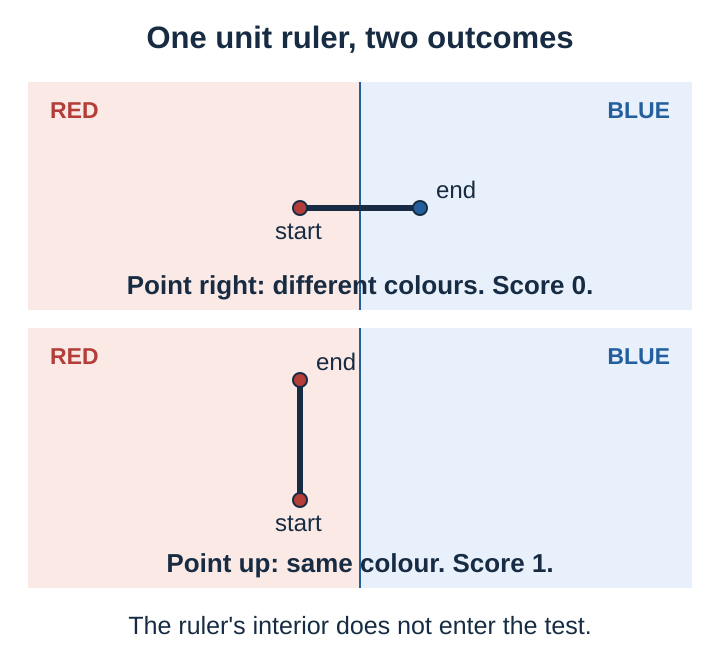

# Understanding the five-colour obstruction

**Start here.** This is the main reading path through our exposition. Lesson 1 builds one idea carefully: what a *weak measurable colouring* means, and why the proof needs it. Lesson 2 shows how that “almost never” condition still forbids some unit distances exactly. Lesson 3 shows how a connected set of robust points turns that exact exclusion on a circle into an exclusion on a band with positive area. You can give feedback on this page without following the supporting folders.

The supplied OpenAI proof, *The Euclidean plane is not five-colorable* (23 September 2026), rules out a proper five-colouring even when its colour classes are not measurable. Together with the classical seven-colouring construction, this gives $6\leq\chi(\mathbb R^2)\leq7$. Here $\chi(\mathbb R^2)$, the chromatic number of the plane, is the fewest colours that allow a proper colouring in the sense of Section 1. The proof does not decide between six and seven. We are explaining that supplied result; our team's local contributions come later.

## 1. A rule that must hold everywhere

Imagine that every point of an infinite sheet receives one of five labels. Whenever two points are exactly distance one apart, their labels must differ.

Put a ruler of length one anywhere on the sheet. Its endpoints must have different colours. Turn it, slide it, move it far away: the same rule must always hold. This is what **proper colouring** means. The interior of the ruler is irrelevant; only its endpoints matter.

This is a graph-colouring problem: points are vertices and unit-distance pairs are edges. Crossing edges are allowed. We are not colouring the countries of a map.

To disprove five-colourability, assume such a colouring exists and derive a contradiction. But we cannot assume it looks like a picture made of coloured regions. Its colour classes could be too irregular even to have well-defined areas. Drawing smooth boundaries at the beginning would silently change the problem.

The proof therefore needs a bridge to objects that we can measure. Before looking at how that bridge is built, let us understand exactly what is on the other side.

## 2. Give one placement of the ruler a score

For a few minutes, use a deliberately simple picture: the left half-plane is red and the right half-plane is blue. Put the dividing line in blue. This is **not** a valid solution to the colouring problem. It is a practice example in which we can see every part of the test.

Place the ruler's starting point half a unit to the left of the dividing line.

Point it right: the start is red and the endpoint is blue. The pair obeys the rule. Give it a score of **0**.

Point it up: both endpoints are red. The pair breaks the rule. Give it a score of **1**.

Call this the **bad-pair score**. A score of 1 records a monochromatic unit pair; a score of 0 records a pair with different colours.

We now give names to the pieces we have already used. Let $p$ be the starting point, and let $u$ be the arrow from start to endpoint. Because the ruler has length one, $u$ is a unit vector. The endpoint is $p+u$. Write the score as $m(p,u)$:

$$
m(p,u)=
\begin{cases}
1 & \text{if the endpoint colours agree},\\
0 & \text{if they differ}.
\end{cases}
$$

So far there is no probability and no integration. We have tested one placement.

## 3. Keep the start still; turn the ruler

Now leave $p$ fixed and turn the ruler through a complete revolution. Its endpoint travels around a circle of radius one.

We are asking for the **fraction of directions that score 1**. That is an ordinary proportion: the total angle of the bad directions divided by one full turn.

In our picture, the endpoint reaches the blue side only while the ruler points within $60^\circ$ of directly right. That is a $120^\circ$ arc. For the other $240^\circ$, the endpoint is red like the starting point.

The bad fraction at this particular starting point is therefore

$$
\frac{240^\circ}{360^\circ}=\frac23.
$$

The two directions that land exactly on the dividing line do not affect this fraction: two individual angles occupy none of the full turn.

Watch one slow turn of the ruler

The animation pauses on the right-pointing, upward-pointing and left-pointing placements. Watch the **current score** switch between 0 and 1. The bad fraction $2/3$ describes the *whole turn*, not the score at a single instant.

Call the bad fraction $s(p)$. The letter reminds us that this number depends on the starting point. To write “average the score over all directions,” mathematicians use

$$
s(p)=\int_{S^1}m(p,u)\,d\sigma(u).
$$

Every symbol now has a job. $S^1$ is the circle of unit directions. The integral averages the 0s and 1s we see during the turn. The measure $\sigma$ gives one full turn total weight 1, so this is a **fraction**, not a total angle. In angle notation, $d\sigma=d\theta/(2\pi)$.

**Pause here:** a score concerns one ruler placement. A bad fraction concerns every direction from one fixed starting point. These are different measurements.

Check the angle calculation

Use coordinates with the dividing line at horizontal coordinate 0 and the starting point $p=(-1/2,0)$. A unit direction at angle $\theta$ is $u=(\cos\theta,\sin\theta)$. The endpoint's horizontal coordinate is $-1/2+\cos\theta$.

It is red precisely when $\cos\theta<1/2$. The boundary angles are $60^\circ$ and $300^\circ$; the red arc between them has length $240^\circ$.

## 4. Now let the starting point move

One fixed start is not enough to describe a colouring of the plane. Slide the pivot as well as turning the ruler.

There is no uniform way to choose a point from the entire infinite plane. Instead, choose a bounded disk $B$ as an **observation window**. Choose $p$ uniformly by area inside it, and independently choose a uniformly random direction.

Only the start must be in the window. The endpoint may lie outside it. The ruler still has exactly length one.

For each start $p$, we already know what to measure: its bad fraction $s(p)$. Average those fractions over the window. Call the result $P_B$:

$$
P_B=\frac{1}{|B|}\int_B s(p)\,dp.
$$

Here $|B|$ means the disk's area. The integral adds the bad fractions with area weights; dividing by $|B|$ makes the result an average between 0 and 1.

There are two equivalent ways to read $P_B$:

- Find the bad fraction at each starting point, then average over the window.
- Choose a random start and a random direction, then ask for the probability that the endpoint colours agree.

Both describe the same two-stage experiment.

Our red-and-blue practice picture makes this probability as large as it can be in some windows. Put a small observation disk well inside the red half-plane, far enough from the boundary that every unit ruler starting there stays red. Then **every** placement scores 1, so $P_B=1$.

For exact coordinates, a disk of radius $1/4$ centred at $(-2,0)$ works. Its rightmost starting point has horizontal coordinate $-7/4$; even a unit step directly right remains left of the dividing line.

Section 5 will require this probability to be zero in every window, so this one window already shows that the example is not a weak colouring. The earlier calculation $s(p)=2/3$ at just one point would not, by itself, establish that: one point has zero area in the outer average.

## 5. Weakness means this probability is zero in every window

A **weak measurable colouring** has measurable colour classes and satisfies

$$
P_B=0
\qquad
\text{for every bounded disk }B\text{ of positive area}.
$$

“Measurable” gives us the area-based language needed for these averages. The regions may still be very irregular; measurability does not give them smooth boundaries.

“Weak” changes the ruler rule. A proper colouring requires **every placement** to score 0. A weak measurable colouring requires the two-stage experiment to score 0 **with probability one**, in every observation window.

A test in a disk near us says nothing about a bad region far away. Requiring zero in **every** window makes the condition follow us wherever we move or enlarge it.

The zero average has force because all the scores are 0 or 1. There are no negative scores to cancel positive ones. If bad placements occupy positive measure in the position-and-direction experiment, their average is positive.

But **probability zero is not the same as impossibility**. Choosing a point uniformly from a disk has probability zero of hitting its exact centre, although the centre is there. Similarly, a weak colouring may have exceptional bad unit pairs.

For a concrete comparison, start with a measurable proper seven-colouring, such as the classical hexagon colouring with its boundary points assigned carefully. Pick a point $q$. Its unit circle is covered by the seven colours, so some colour $i$ occupies a positive fraction of that circle; in the hexagon colouring the circle passes through the interiors of several hexagons. Because the colouring is proper, $i$ is not $q$'s own colour. Recolour $q$ alone with colour $i$.

Properness is destroyed. Even the turning test of Section 3 now fails at this one start: $s(q)$ equals the fraction of the circle coloured $i$, which is positive.

Weakness survives. The original colouring was proper, so every new bad pair has $q$ as an endpoint. From any other start $p$, at most one direction points exactly at $q$, and a single direction occupies none of the full turn, so $s(p)$ is still 0. Only $s(q)$ is positive, and a single start has zero area, so $P_B=0$ in every window.

This is why the definition averages over starting points instead of demanding $s(p)=0$ at every $p$: a single exceptional start can have a positive bad fraction without changing any window's average.

We will say that something holds for **almost every** placement, or start, when the exceptions have **zero measure in this particular sampling experiment**.

A precision note about measurability

For the fixed-centre discussion, take the finitely many colour classes to be Borel sets forming a partition. Then the angular samples are measurable at every fixed $p$. The score $m(p,u)$ is jointly Borel in position and direction, so by Tonelli's theorem $p\mapsto s(p)$ is measurable and the window average $P_B$ is well defined. This loses no generality under manuscript Definition 1.2: any measurable colouring can be changed on a null set so that its classes are Borel, and such a change preserves weakness (next paragraph). With arbitrary Lebesgue-measurable representatives, the corresponding sections are guaranteed only for almost every centre.

Changing a colouring on a plane-null set preserves weakness. Cover that set by a Borel null set $N$. For each fixed $u$, the affected starts lie in $N\cup(N-u)$, still a null set. Integrating these zero-area sections over directions gives a null set of affected position-and-direction pairs.

## 6. Assemble the manuscript's formula

The long formula is a compact way to record the experiment we have built.

The only piece still hidden inside $m(p,u)$ is how to check whether the colours agree. Name the colour classes $A_1,\ldots,A_k$; each point belongs to exactly one class.

The **indicator** $1_{A_i}(p)$ is a yes-or-no test written as a number: 1 if $p$ has colour $i$, and 0 otherwise. For that one colour, multiply the two endpoint tests:

$$
1_{A_i}(p)\,1_{A_i}(p+u).
$$

The product is 1 only when **both** endpoints have colour $i$. If either endpoint fails the test, one factor is 0, so the product is 0.

Now add over all colours:

$$
m(p,u)=\sum_{i=1}^{k}1_{A_i}(p)\,1_{A_i}(p+u).
$$

If the endpoint colours agree, exactly one term is 1. If they differ, every term is 0. The sum reproduces our original bad-pair score.

Substitute this score into the two averages we have already built:

$$
P_B=
\frac{1}{|B|}
\int_B
\int_{S^1}
\sum_{i=1}^{k}1_{A_i}(p)\,1_{A_i}(p+u)
\,d\sigma(u)\,dp.
$$

Read **from the inside outward**: test the endpoints, average over the turn, then average over the starting window.

Because we require $P_B=0$, we can multiply by the positive area $|B|$ without changing the condition. We can also move the finite sum outside the integrals. We arrive at the manuscript's form:

$$
\sum_{i=1}^{k}
\int_B\int_{S^1}
1_{A_i}(p)\,1_{A_i}(p+u)
\,d\sigma(u)\,dp=0.
$$

The notation compresses three familiar actions: **test, turn, move**.

Match this wording precisely to the source

The manuscript tests origin-centred disks $B(0,R)$ for every $R>0$. This is equivalent to testing every bounded disk: any such disk lies in a sufficiently large origin-centred disk, and the score is nonnegative.

The relevant measure is **position times direction**. Choosing two independent plane points would give a different, useless test: the second would have probability zero of lying exactly one unit from the first, regardless of the colouring. Our construction builds the unit-distance constraint into the experiment by using $p+u$ with $u\in S^1$.

See the [manuscript](../Main/ResearchSnapshot/remote/attachments/here-are-three-files-ni5n/paper.pdf), Definition 1.2, and [Coloring.lean](../Main/ResearchSnapshot/local/work/encoding-integration/full-original/OAI/Geometry/PlaneColoring/Coloring.lean), <code>WeakColoring</code>. The formal definition uses almost-everywhere measurability and a product-almost-everywhere exclusion.

## 7. What this buys the proof

We wanted a rule about every unit pair. Why spend so long on a condition that allows exceptions?

Because the measurable replacement lets the proof talk about **how much of a small disk has a given colour**. For an arbitrary colour class, that question may have no answer. For a measurable class, it becomes a quantity we can estimate.

Here is the intuition for the next step. Suppose two locations are one unit apart, and around each location the same colour fills a fraction of a small centred disk that tends to 100% as the disk shrinks. A unit ruler placed near that pair has very little room to avoid landing in that colour at both ends. The supplied manuscript's Lemma 4.3 turns this into a positive-measure family of bad placements, contradicting weakness.

“Almost every” therefore still has geometric force. It can rule out an exact unit-distance relation between suitably robust locations.

Such locations are not rare. A classical theorem, Lebesgue's density theorem, says that for a measurable set, at all of its points outside a zero-area set, the fraction of a small centred disk occupied by the set tends to 100% as the disk shrinks. So for any tolerance, say 99%, every small enough disk centred at such a point is at least 99% filled, although it need not be completely filled. This is a standard result of real analysis, not part of the supplied manuscript or our team's work. The next lesson will develop this step: what this property means precisely, and why it makes the bad placements occupy positive measure.

One large task remains before we can use any of this: our original hypothetical proper colouring might not be measurable. We cannot simply insert its colour classes into the integrals.

The supplied **transfer theorem** builds a new weak measurable colouring from the existence of an unrestricted proper colouring, using the same finite number of labels. This is a substantial analytic result. It is not ordinary smoothing, and the new colouring is not asserted to agree with the original one.

The overall logic is now visible:

1. If a proper five-colouring existed, the transfer theorem would produce a weak measurable five-colouring.
2. The geometric part of the proof shows that no weak measurable five-colouring exists.
3. Therefore no proper five-colouring exists.

That is the role of the definition we have just built.

## A place to stop and respond

Before moving on, try saying what each zero means:

- $m(p,u)=0$;
- $s(p)=0$;
- $P_B=0$.

Compare your reading

- This one placement has different endpoint colours.
- From this fixed start, almost every direction gives different endpoint colours.
- For almost every start in this window, almost every direction gives different endpoint colours.

The bad fractions $s(p)$ are never negative, so their window average can be 0 only if $s(p)=0$ for every start in the window outside a zero-area set. The third statement can therefore tolerate exceptional starting points; it does not imply the second at every $p$. The recoloured point $q$ in Section 5 is exactly such an exception. All three use the same unit ruler, but they quantify over different things.

**Feedback on Lesson 1:** name the first sentence where you had to take something on trust, or the first picture that did not help you make a new inference. Section numbers give us a stable way to discuss it. Lesson 2, below, develops the density step previewed in Section 7.

## Lesson 2: from “almost never” to “never”

Lesson 1 ended with a promise. A weak colouring is allowed exceptional bad pairs, yet the proof needs some unit-distance relations to be ruled out **exactly**. This lesson shows how: if two points sit *robustly* inside the same colour, they can never be exactly one unit apart.

This is the supplied manuscript's Lemma 4.3. The argument below is our slow version of it, with explicit numbers. Sections 9 and 14 also use one classical fact from real analysis, Lebesgue's density theorem, which is not part of the manuscript or our team's work. The argument for the lemma itself needs only the definition of a robust point. This lesson is new and has not yet received outside reader feedback.

## 8. One bad ruler is invisible

Return to the recoloured point $q$ of Section 5. Many rulers starting at $q$ are bad; even its whole turning test fails, since $s(q)>0$. Yet every window still has $P_B=0$, because a single start has zero area, and from every other start at most one direction reaches $q$ (Section 5).

So weakness cannot see one bad pair, or even every bad pair through one point. To contradict weakness, we must find bad placements that fill a **positive share** of some window's experiment.

The plan of this lesson: show that if two suitably robust points of the same colour were one unit apart, a whole family of nearby rulers would be bad, enough to make $P_B$ positive.

## 9. Points that sit robustly inside a colour

Say that a point $a$ is **robustly inside** colour $i$ when the fraction of the disk $B(a,h)$ of radius $h$ centred at $a$ that is coloured $i$ tends to 100% as $h$ shrinks. The standard name is a **density-one point** of the colour class $A_i$.

Unpacked: pick any tolerance, say 99%. Then every small enough disk centred at $a$ is at least 99% colour $i$. It need not be 100%; tiny specks of other colours may remain at every scale.

Three remarks make this definition concrete.

**Having a colour is not the same as sitting robustly inside it.** From now on, take the point $q$ of Section 5 inside a hexagon, not on an edge. After recolouring, $q$ carries colour $i$, but every small enough disk around $q$ is entirely its old colour apart from the single point $q$. Colour $i$ occupies 0% of those disks. So $q$ is robustly inside its *old* colour, not the colour it now carries.

**A point cannot sit robustly inside two colours.** A small disk cannot be at least 99% red and also at least 99% blue, since the colour classes do not overlap.

**Almost every point is robust.** Lebesgue's density theorem, met in Section 7, says that for each colour, all of its points outside a zero-area set are robustly inside it. Since the colours cover the plane, all points outside a zero-area set are robustly inside their own colour.

## 10. Suppose two robust points of one colour are one unit apart

Let $a$ and $b$ both be robustly inside colour $i$, with $|b-a|=1$. Write $u_0$ for the unit direction from $a$ to $b$, so that $b=a+u_0$.

Choose a small radius $h$ such that:

- the disk $B(a,h)$ is at least 99% colour $i$;
- the disk $B(b,2h)$ is at least 99% colour $i$.

Robustness at both points guarantees that every small enough $h$ works. The next section explains why the disk around $b$ needs radius $2h$ rather than $h$.

Our goal is to show that many rulers near the segment from $a$ to $b$ have both ends coloured $i$. Each of these is a **bad** placement in Lesson 1's sense: score 1.

## 11. Slide the ruler, then turn it slightly

**Slide.** Start the ruler anywhere in the disk $B(a,h)$ and point it in the direction $u_0$. Its endpoint lands in $B(b,h)$, a copy of the start disk slid one unit along $u_0$.

The picture shows the one thing the slide gives: the rulers from $B(a,h)$ in direction $u_0$ end exactly in the slid copy $B(b,h)$. Both disks are mostly colour $i$, so most of these rulers are bad.

But one direction alone is not enough. Sections 3 and 5 noted that a single direction occupies none of the full turn, so rulers in one direction cannot fill a positive share of the experiment.

**Turn slightly.** Allow every direction $u$ within angle $h$ (in radians) of $u_0$. This **fan** of directions is a fraction $2h/(2\pi)=h/\pi$ of the full turn, which is positive.

Turning costs something. When a unit ruler turns through a small angle, its tip moves along an arc of that length, and the straight-line distance between the two tip positions is shorter still. So $|u-u_0|<h$. With the start within $h$ of $a$, the endpoint $p+u$ is within $h+h=2h$ of $b$:

$$
|p+u-b|\le |p-a|+|u-u_0|<h+h=2h.
$$

That is why the landing disk has radius $2h$. Doubling the radius multiplies the area by 4.

The inference to take from the picture is that the fan costs one doubling of the landing radius: the tips no longer all land in $B(b,h)$, but they all stay inside $B(b,2h)$, whose area is four times that of $B(a,h)$.

## 12. Count failures, one direction at a time

Fix one direction $u$ in the fan. A start $p$ in $B(a,h)$ gives a ruler with both ends coloured $i$ unless one of two things goes wrong.

1. **The start is not colour $i$.** At most 1% of the start disk is like this.
2. **The endpoint is not colour $i$.** The endpoint lies in the landing disk $B(b,2h)$, which is at most 1% non-$i$. The starts whose endpoint lands in that non-$i$ part lie inside a copy of it, slid back by $u$. Sliding does not change area. So these starts have area at most 1% of $B(b,2h)$, which is 4% of the start disk.

At most $1\%+4\%=5\%$ of starts fail. So **for every direction in the fan, at least 95% of the start disk gives a bad ruler**.

The failing starts may change from one direction to the next. Only their share is controlled, and it is at most 5% in every direction.

Read the three slices as one claim: the starts that fail because their endpoint misses colour $i$ can change with the direction (they are the non-$i$ part of $B(b,2h)$, slid back by $u$), and the argument never needs to know where they are, only that all failures together are at most 5% of the disk every time.

## 13. The contradiction, in one window

Now use the start disk itself as the observation window: $B=B(a,h)$.

Lesson 1 fixed each start and averaged over directions. Because the start and the direction are chosen independently, the same probability can be found the other way round: fix each direction and average over starts. Section 12 has already done the inner step.

- With probability $h/\pi$, the direction lands in the fan.
- Given that, the start gives a bad ruler with probability at least $0.95$.

Therefore

$$
P_B\ \ge\ 0.95\cdot\frac{h}{\pi}\ >\ 0.
$$

But weakness demands $P_B=0$ in every window. This contradiction shows that the starting assumption was impossible.

**Conclusion (manuscript Lemma 4.3).** In a weak measurable colouring, two points robustly inside the same colour are never exactly one unit apart.

A single bad pair between robust points does not stay single. Robustness at both ends spreads it into a fan of bad rulers that fills a positive share of a window.

Why 99%, and why the radii h and 2h?

Nothing depends on 99%. With tolerance $\varepsilon$ (missing fraction $\varepsilon$ in both disks), the count in Section 12 gives at most $\varepsilon+4\varepsilon=5\varepsilon$ failing starts per direction, so any $\varepsilon<1/5$ closes the argument. At $\varepsilon=1/5$ the count gives no positive share, and the argument says nothing.

The ratio $2:1$ is a convenience. Use a narrower fan, of directions within angle $\delta h$ of $u_0$, with landing radius $(1+\delta)h$. The failure budget becomes $\varepsilon\big(1+(1+\delta)^2\big)$. For any $\varepsilon<1/2$, a small enough $\delta$ keeps this below 1. What matters is only that the budget is strictly below 1.

A precision note

With Borel colour classes (Section 5's precision note), the set of bad placements is a Borel subset of position-times-direction. Choosing the direction first is Tonelli's theorem applied to the nonnegative score $m(p,u)$; it is the second reading of $P_B$ in Section 4. The count in Section 12 uses only that a translate of a set has the same area.

The bound $|u-u_0|<h$ holds because a chord of the unit circle is shorter than its arc.

## 14. What this gives, and what it does not

**What it gives.** Give each robust point the colour it is robustly inside. By Section 9, this **robust colour** is unique and is defined everywhere outside a zero-area set. By Section 13, no two robust points with the same robust colour are exactly one unit apart.

So on the robust points the robust colouring is exactly proper, with no exceptions at all. Here “almost never” has become “never”.

**What it does not give.**

- **It concerns robust colours, not the labels themselves.** The recoloured point $q$ is robust in its old colour but carries colour $i$. More drastically, give every point of one straight line the same colour. A line has zero area, so every $P_B$ stays zero (Section 5's precision note) and every robust colour is unchanged. Yet the line now contains same-label pairs exactly one unit apart. When both endpoints of such a pair are robust, their robust colours, inherited from the surrounding hexagons, still differ, exactly as Section 13 requires.
- **Pairs that touch non-robust points are uncontrolled.** On a hexagon edge, no colour fills more than half of any small enough disk (exactly half at an edge point, a third at a corner), so edge points are not robust in any colour. The lemma says nothing about unit pairs that have such a point as an endpoint.
- **It is not a colouring of the whole plane, and on its own it does not count colours.** It is a tool. The technical map below shows one place where the manuscript uses it.

## A second place to stop and respond

Try to answer these before opening the comparison.

1. Why does a bad pair through the recoloured point $q$ leave every $P_B$ at zero, while a bad pair between two robust points forces some $P_B$ to be positive?
2. If $a$ is robustly inside colour $i$, must $a$ itself carry colour $i$?
3. Where does the factor 4 in Section 12 come from?

Compare your reading

1. At $q$, every bad ruler has $q$ as an endpoint. Starts at $q$ have zero area, and from any other start at most one direction ends at $q$. Around two robust points, nearby starts are at least 99% colour $i$, and so are the disks where nearby endpoints land. A positive share of starts, across a positive fan of directions, then gives bad rulers.
2. No. The recoloured $q$ is robustly inside its old colour but carries colour $i$. Robustness is a fact about small disks around a point, not about the point's own label. It is also not the same as being surrounded: a robust point's small disks need not be completely filled.
3. Turning the ruler by up to angle $h$ moves its tip by less than $h$, so the endpoints lie within a disk of radius $2h$ around $b$. Twice the radius means four times the area, so a 1% missing share of that disk can be up to 4% of the start disk.

**Feedback on Lesson 2:** name the first sentence where you had to take something on trust, or the first picture that did not help you make a new inference. The three Lesson 2 figures are first drafts.

## Lesson 3: from a circle to a band — straddling a connected set

Lesson 2 showed that a robust point excludes its own colour, exactly, from the robust points on its unit circle. But a circle has zero area, and weakness cannot feel zero area. This lesson shows how a *connected* set of robust points thickens that circle into a band with positive area.

The tool is elementary: the intermediate value theorem. It is the geometric engine behind the manuscript's “straddle” regions. The manuscript applies it to constructed two-colour interfaces. Here we use the simplest model, a set lying robustly inside one colour. That model is our illustration, not the manuscript's statement.

## 15. What one robust point excludes

Let $q$ be robustly inside colour $i$. By Section 13, no point at distance exactly 1 from $q$ is robustly inside colour $i$.

That is exact, but it lives on a circle, and a circle has zero area. Recolouring the whole circle with colour $i$ would change no window average (compare the recoloured line in Section 14). To reach a statement with area in it, we need many centres whose unit circles sweep out a region.

## 16. Many centres: the straddle region

Let $K$ be a set of centres, for example a short segment. For a point $z$, look at its distances to all the points of $K$. Say that $z$ **straddles** $K$ when some point of $K$ is closer than 1 and some point of $K$ is farther than 1:

$$
\Delta(K)=\{z:\ \min_{q\in K}|z-q|<1<\max_{q\in K}|z-q|\}.
$$

This is the manuscript's straddle region (manuscript Section 7; `Straddle` in the Lean development). Section 17 shows that when $K$ is connected, every straddling point lies on the unit circle of some point of $K$. So $\Delta(K)$ sits inside the region swept by those circles.

The inference to take from the picture is that a segment of centres turns a single unit circle, which has zero area, into a band $\Delta(K)$ with positive area, swept by the unit circles of the points of $K$.

## 17. Straddling forces an exact contact

**Contact lemma.** If $K$ is connected and $z$ straddles $K$, then some point of $K$ is at distance exactly 1 from $z$.

For a segment, walk along $K$ from a point closer than 1 to a point farther than 1. The distance to $z$ changes continuously, without jumps, so at some moment it equals 1.

Read the picture as the walk itself: as the far end of the ruler moves along $K$ its length passes from below 1 to above 1, so it must cross the dashed unit circle of $z$ at a point of $K$.

A general connected set may contain no path to walk along, but the conclusion survives. The distance $q\mapsto|z-q|$ is continuous, and a continuous function on a connected set takes every value between any two values it takes. This is a classical fact of topology, not part of the manuscript.

**Connectedness is essential.** Let $K$ be only the two endpoints of a segment of length 2, and let $z$ be the first endpoint. Its distances to $K$ are 0 and 2, so $z$ straddles $K$, yet no point of $K$ is exactly one unit away. Restore the whole segment and the midpoint supplies the contact. The missing middle is exactly where the contact would have been.

The picture shows that without connectedness the distance can jump straight from 0 to 2, so straddling alone does not force a point of $K$ onto the unit circle of $z$.

## 18. A band that colour $i$ cannot occupy

Combine the contact lemma with Lesson 2. Suppose $K$ is compact and connected, contains at least two points, and every point of $K$ is robustly inside colour $i$.

Take any $z$ in $\Delta(K)$. By the contact lemma, some $q$ in $K$ satisfies $|z-q|=1$. Since $q$ is robustly inside colour $i$, Section 13 says $z$ is not.

So no point of $\Delta(K)$ is robustly inside colour $i$. By Lebesgue's density theorem (Section 9), all colour-$i$ points outside a zero-area set are robust in colour $i$. Therefore **colour $i$ occupies zero area of $\Delta(K)$**.

This is now a statement with area in it, because $\Delta(K)$ has positive area. Take $K$ to be a segment of length $L>0$, and put $z$ on its perpendicular bisector at distance $d$ from the midpoint, with $d$ slightly less than 1. The nearest point of $K$ is the midpoint, at distance $d<1$. The endpoints are at distance $\sqrt{d^2+L^2/4}$, which exceeds 1 once $d$ is close enough to 1. Both the nearest and the farthest distance change continuously as $z$ moves, so every point near this $z$ also straddles $K$. A whole small disk lies in $\Delta(K)$.

One robust point excluded its colour on a circle, which weakness cannot see. A robust connected set excludes it on a band, which weakness can.

**Sanity check.** In the proper hexagon colouring, let $K$ be a short segment inside an open hexagon of colour $i$. Every point of $\Delta(K)$ is exactly one unit from some point of $K$, so properness forbids colour $i$ there, with no exceptions. The weak version says the same thing up to zero area.

A precision note

The nearest and farthest distances to a compact $K$ are continuous in $z$; each changes by at most $|z-z'|$ when $z$ moves to $z'$. So $\Delta(K)$ is open and therefore measurable. The contact lemma needs no compactness, only connectedness: with infimum and supremum in place of minimum and maximum, the argument is unchanged.

## 19. What the manuscript actually needs

Our model assumed that $K$ lies robustly inside one colour. In the proof, the connected sets come from a constructed loop of colour *interfaces*: compact connected sets $K_j$ sharing a centre $x$. Each carries a **pair** of labels, and the manuscript shows that both are absent almost everywhere in $\Delta(K_j)$ (manuscript Section 7).

Proving that two-label exclusion requires the manuscript's analytic interface construction. Connectedness alone does not give it. What carries over from this lesson is the geometric engine: straddling a connected set forces an exact unit contact, and the straddle region has area. The next lesson explains where the interfaces come from.

## A third place to stop and respond

1. Why does one robust point exclude its colour only on a zero-area set, while a robust segment excludes it on a region with area?
2. With $K$ the two endpoints of a length-2 segment and $z$ the first endpoint, why is there no contact? What changes when $K$ is the whole segment?
3. Must the contact point be unique?

Compare your reading

1. One point's unit circle has zero area. A segment's points have unit circles that sweep the band $\Delta(K)$, and the contact lemma says every point of that band lies on one of those circles.
2. The distances jump from 0 to 2 with nothing in between. The whole segment supplies every intermediate distance, and the midpoint is at exactly 1.
3. No. If $z$ is less than 1 from the middle of a segment but more than 1 from both endpoints, the distance crosses 1 twice, once on each side.

**Feedback on Lesson 3:** name the first sentence where you had to take something on trust.

## Lesson 4: interfaces, a common centre, and the 60° cone

Lesson 3 used a connected set lying robustly inside one colour, and it excluded that one colour from a band. The proof needs more: connected sets that sit *between* two colours and exclude **both**. This lesson builds that idea in a model. It then shows where several such sets can meet at one centre, and states our team's CC60 theorem about that meeting.

Source boundaries in this lesson:
- The interface model in Section 20 and the shadow pictures in Sections 22–23 are our illustrations.
- The constructed interfaces in Section 21 belong to the supplied manuscript.
- CC60 in Section 24 is a team result, with a recorded Lean verification.
- The six-colour instance and the hexagon check in Section 24 are our illustrations of CC60's statement.

## 20. An interface excludes two colours: a model

Take a short segment $K$ with an open region of colour $A$ along one side and an open region of colour $B$ along the other, each bordering the whole segment. Every point inside an open region of one colour is robustly inside that colour: small disks around it are 100% that colour.

Let $z$ straddle $K$. Lesson 3's contact lemma gives a point $q$ of $K$ exactly one unit from $z$. More is true for a segment: the unit circle around $z$ **crosses** $K$ at a point strictly between its ends, rather than just touching it. Near that crossing, the circle passes into the $A$ side and into the $B$ side.

So the unit circle around $z$ contains robust points of colour $A$ and robust points of colour $B$. By Section 13, $z$ is robustly inside neither. By Lebesgue's density theorem, **colours $A$ and $B$ both occupy zero area of $\Delta(K)$**.

The inference to take from the picture is that a unit circle crossing the interface passes through robust points of both colours, so its centre $z$ is robustly inside neither.

**Check with the hexagon colouring.** Let $K$ be an edge shared by an $A$-hexagon and a $B$-hexagon. Every point of $\Delta(K)$ has a unit circle that dips into both hexagons, so properness forbids both $A$ and $B$ there, with no exceptions.

Why the circle crosses rather than touches

Measure the distance from $z$ along the segment. That distance is a convex function of position, and it passes from below 1 to above 1. A convex function cannot be level at a point where it equals 1 when it is below 1 somewhere: that point would be a minimum. So the distance is strictly changing where it equals 1, and the circle is not tangent to the segment there. A circle that crosses a line at a point passes to both sides of the line nearby. The crossing is strictly between the ends: it lies strictly between a point of $K$ closer than 1 and the farther endpoint. (Both ends may be more than 1 away; then the circle crosses $K$ twice.)

## 21. What the proof actually constructs

A weak colouring need not contain any clean edge between two open colour regions. Assuming a weak measurable five-colouring, the manuscript therefore **manufactures** interfaces from limiting data:

- At a centre, it studies colour proportions on circles whose radii approach 1. Their limits, called traces, give a **palette** at each direction: the labels that persist there (manuscript Section 5; Lesson 5 says more).
- Changes between labels are organised into a graph on the labels (Section 6).
- A topological argument produces compact connected sets $K_j$, each containing the same centre $x$. Each carries the two labels at the ends of one edge of a cycle of 3, 4 or 5 labels (a cyclic list of labels; its edges need not be edges of the graph above); both are absent almost everywhere in $\Delta(K_j)$, and points of $K_j$ approach $x$ from a chosen direction (Proposition 7.1).

That last conclusion is exactly what Section 20's model gives for free. In the manuscript it is a substantial analytic theorem, not a consequence of connectedness alone. From here on we use only its *conclusion*: an interface $K_j$, a pair of labels, and their absence from $\Delta(K_j)$.

## 22. A tiny interface casts its shadow on the unit circle

Suppose $K$ lies within distance $\delta$ of a centre $x$. Every distance from a point $z$ to $K$ is then within $\delta$ of $|z-x|$. For $z$ to straddle $K$, some of those distances must be below 1 and some above, so $|z-x|$ is within $\delta$ of 1. **The exclusion region of a tiny set near $x$ hugs the unit circle around $x$.**

Which side of the circle? Model $K$ as a short segment of length $L$ leaving $x$ in direction $\theta$.

- A point just **outside** the circle, on the half facing $\theta$, is more than 1 from $x$ but less than 1 from some point of the segment. It straddles.
- A point just **inside** the circle, on the opposite half, is less than 1 from $x$ but more than 1 from the far end. It straddles too.

So the shadow is a thin crescent outside the circle on the side the interface points toward, and a thin crescent inside on the far side. Each is about $L$ thick at its middle and only of order $L^2$ thick near the two directions perpendicular to $\theta$. There the inner crescent reaches slightly past the perpendiculars, onto the facing half.

Read the picture as one claim: every point of $\Delta(K)$ is within $L$ of the unit circle around $x$, outside it on the side $K$ points to and inside it on the far side, so a tiny interface excludes its labels only from a thin band hugging that circle.

## 23. Several interfaces at one centre

Now let several interfaces $K_1,\dots,K_n$ meet at the same centre $x$, leaving in directions $\theta_1,\dots,\theta_n$, with label pairs $P_1,\dots,P_n$.

Where outer crescents overlap, every label in $P_1\cup\dots\cup P_n$ is excluded (almost everywhere). Each outer crescent covers every direction less than $90^\circ$ from its own $\theta_j$, so they overlap, in a thin band of positive area, over the directions less than $90^\circ$ from every $\theta_j$. If the $\theta_j$ spread over an angle $w$, these form an open arc of width exactly $180^\circ-w$. For $w\le 60^\circ$, that common arc is at least $120^\circ$ wide.

So a narrow cone of interfaces leaves a long thin region, hugging the unit circle, where only the labels outside every pair may appear. How few can those leftover labels be?

![A centre x with its unit circle dashed. Two short segments K1 and K2 of length 0.3, exaggerated, leave x in directions 20 degrees above and below east, 40 degrees apart. With six labels, the straddle region of K1, shaded blue, excludes labels 1 and 2, and that of K2, shaded green, excludes labels 3 and 4. Where they overlap, shaded red, only labels 5 and 6 could appear: a long thin crescent just outside the circle on the side the segments point to, and a matching crescent inside the circle on the far side.](Figures/interface-cone.svg)

The picture shows that two interfaces $40^\circ$ apart leave a long band of positive area, hugging the unit circle, in which only the two leftover labels 5 and 6 could appear, up to zero area.

## 24. CC60: at least three labels must survive

**CC60 (closed $60^\circ$ cone; team result).** Take a weak measurable colouring, with any finite number of labels. Fix a centre $x$. Take finitely many sets $K_1,\dots,K_n$, each containing $x$, and for each a direction $v_i$ such that $K_i$ contains points tending to $x$ whose directions from $x$ tend to $v_i$. Suppose all the $v_i$ lie in one closed $60^\circ$ arc of directions. For each $i$, let $F_i$ be a set of labels, each occupying zero area of $\Delta(K_i)$. Then the labels outside every $F_i$ cannot fit into a pair: **at least three survive**. The sets need not be connected or compact.

“Closed” matters: directions exactly $60^\circ$ apart are included. The team's [cone packet](../Main/ResearchSnapshot/local/outputs/cone/REPORT.txt) records successful Lean 4.34.1 checks of the statement and proof, with an axiom audit listing only `propext`, `Classical.choice` and `Quot.sound`. An [independent referee report](../Main/ResearchSnapshot/local/outputs/ASTRA-CONE-REFEREE.txt) reviews the hypotheses. This walkthrough has not rebuilt the Lean files, and this lesson does not reconstruct the proof.

**A six-colour instance.** Two interfaces at $x$ carry the pairs $\{1,2\}$ and $\{3,4\}$, with directions $40^\circ$ apart. Their exclusions would leave only $\{5,6\}$. CC60 says this configuration cannot occur. If instead the pairs were $\{1,2\}$ and $\{1,3\}$, three labels, 4, 5 and 6, would survive: exactly the minimum CC60 allows, so it forbids nothing here.

**A consistency check.** At a vertex of the hexagon colouring, three edges leave in directions $120^\circ$ apart. Each edge satisfies CC60's hypotheses for its pair, but no two edges fit in a $60^\circ$ cone. So CC60 applies to one edge at a time, where five of the seven labels survive. It forbids nothing that the valid colouring does.

## 25. What CC60 does not say

- **It is not a six-colour impossibility theorem.** It forbids a kind of local configuration. Nothing yet shows that every hypothetical six-colouring must produce it.
- **It is about actual interfaces, not lists.** Its hypotheses are actual sets through one common centre, actual approach directions, and zero-area exclusions on their actual straddle regions. A list of arrows and label pairs supplies none of this; the sets and exclusions must be constructed, as the manuscript does for five colours.
- **A direction records one way of approaching, not a shape.** Each $v_i$ says only that some points of $K_i$ approach $x$ from that direction. The set may also approach $x$ from other directions, and away from $x$ it may go anywhere. Directions are signed: $v_i$ and $-v_i$ differ, and a direction may not be reversed to fit the cone.
- **It does not change the supplied bound.** The bound remains $6\le\chi(\mathbb R^2)\le7$.

The next lesson shows how palettes at three centres one unit apart can contradict each other, and how that relates to the supplied proof's original machinery.

## A fourth place to stop and respond

1. In Section 20, why does an interface exclude **two** colours from $\Delta(K)$, when Lesson 3's single-colour set excluded one?
2. A tiny interface leaves $x$ pointing east. Where, near the unit circle around $x$, does its shadow lie?
3. Six labels. Interfaces at $x$ carry $\{1,2\}$ and $\{3,4\}$, with directions $50^\circ$ apart. What does CC60 conclude? What if they were $90^\circ$ apart?

Compare your reading

1. The unit circle around a straddling point crosses the interface, so it meets both sides. Robust points of both colours lie on it, so by Section 13 $z$ is robustly inside neither colour, and Lebesgue's density theorem turns that into zero area for both.
2. Just outside the circle on its eastern half, and just inside on its western half, thinning toward north and south.
3. At $50^\circ$ apart, only $\{5,6\}$ would survive, so CC60 rules the configuration out. At $90^\circ$ apart, the two directions don't fit in one $60^\circ$ cone. CC60 then applies only to each interface alone, where four labels survive, and forbids nothing.

**Feedback on Lesson 4:** name the first sentence where you had to take something on trust.

## Lesson 5: three centres and one leftover label

Lesson 4 worked in the plane: interfaces, straddle regions, cones. The manuscript also argues one level up, with **palettes**, the limiting angular data that Section 21 introduced. This lesson takes one manuscript lemma about palettes and proves it twice.

- The manuscript's own proof turns one direction slightly so that a distance becomes exactly 1.
- Our team's replacement uses three centres at the corners of a unit triangle and a counting argument with labels.

Source boundaries in this lesson:
- Palettes, traces, states and the lemma itself belong to the supplied manuscript (Sections 5–6) and its Lean development.
- The three-centre proof in Sections 29–30 is a team result, with recorded Lean checks. Its forced-label step already appears in the manuscript's proof of Lemma 6.7, with one shifted centre and the $60^\circ$ exclusion in place of the third centre.
- The five-label example in Section 29 is our illustration.

## 26. Palettes, a little more precisely

Fix a centre $x$. Draw circles of radius close to 1 around centres close to $x$, and record which colour sits at each direction on each circle. Take limits of these records as the centres approach $x$ and the radii approach 1. Call a point *typical* if it is robustly inside its own colour (Section 9), and a circle typical if almost every point on it is typical; the manuscript records colours only on typical circles. Here a limit means that, on every fixed arc of directions, the share of each colour converges. This is called a *weak limit*; it has nothing to do with weak colourings. Such a limit of the colour records (1 for the colour present, 0 for the others) is a **trace**. Constant sequences are allowed: the circle may already be centred at $x$ with radius 1. At almost every direction a trace gives a list of nonnegative numbers, one per label, that sum to 1.

Roughly, the **palette** $P_x(e)$ is the set of labels that some trace makes positive at direction $e$. Traces are defined only up to null sets of directions, so manuscript Definition 5.1 takes an *essential union* over traces, and $P_x$ is likewise defined only up to a null set. Two facts are all this lesson needs.

1. **One trace is enough to put a label in the palette.** If a single trace gives label $i$ positive weight at direction $e$, then $i\in P_x(e)$, for almost every $e$ (the null set may depend on the trace).
2. **Palettes are almost never empty.** At almost every direction a trace's weights sum to 1, so some label has positive weight there; by fact 1 that label is in the palette.

A palette is *not* the colour of the point $x+e$. It records which labels persist near that direction under limits, and it can contain several labels.

## 27. Unit-separated centres have disjoint palettes

Take two centres $x$ and $y$ exactly one unit apart. For every direction $e$, the points $x+e$ and $y+e$ are also exactly one unit apart: both centres have moved by the same vector.

Heuristically, a label persisting at direction $e$ around both centres would put one colour near both ends of many unit segments, which weakness forbids. This is only intuition: passing from sampled colours to limiting palettes is the hard part. The manuscript proves it (Lemma 5.2 with Remark 5.3), and the Lean development states it as `palette_neighbor_disjoint`:

$$
P_x(t)\cap P_y(t)=\varnothing\quad\text{for almost every direction }t,\qquad |x-y|=1.
$$

The direction $t$ is **common** to both centres. That is what makes the next sections work.

## 28. States, and traces that avoid a set of labels

A **state** at $x$ is a measurable set $A$ of directions together with a set of labels $J$, such that $J\subseteq P_x(t)$ for almost every $t$ in $A$ (manuscript Section 6.2; `RealState` in Lean). A state asserts inclusion, not equality: the palette may contain more than $J$.

The **support** of $A$ is the set of directions every neighbourhood of which meets $A$ in positive measure. Support is stronger than closure: a direction can be a limit of directions in $A$ without being in its support.

From here on, identify the plane with the complex numbers and name a direction by its angle, so $e^{ib}=(\cos b,\sin b)$. In this lesson $A$ and $B$ are sets of directions and $J$, $K$ are sets of labels, not the window or the interfaces of earlier lessons.

Now the key supplied fact (`state_support_avoiding_trace`). Let $B$ be a state at $x$ with labels $K$, and let $b$ be a direction in the support of $B$. Then the centre $y=x+e^{ib}$, one unit from $x$ in direction $b$, carries a trace that gives **zero** weight to every label in $K$.

Why support: the proof picks directions $t$ in $B$, outside null sets, ever closer to $b$. Almost every point of the radius-1 circle about $x+e^{it}$ has a colour outside $P_x(t)\supseteq K$ (manuscript (5.2)), and a weak limit of these circles is the trace. The manuscript's proof of Lemma 6.7 begins with the same construction.

Combine this with fact 2 of Section 26. That trace sums to 1 but is zero on $K$, so it is positive on some label outside $K$. By fact 1 that label is in the palette. So:

$$
P_y(t)\not\subseteq K\quad\text{for almost every }t.
$$

Read the conclusion carefully. It says the palette at $y$ has *some* label outside $K$. It does not say the palette avoids $K$ entirely; other traces may contribute labels of $K$.

## 29. The counting step, with five labels

Here is the whole finite argument, on an example. Use labels $\{0,1,2,3,4\}$ and split them as

$$
J=\{0,1\},\qquad K=\{2,3\},\qquad X=4 .
$$

Suppose three palettes $P$, $Q$, $R$ (at one common direction) satisfy:

- $J\subseteq P$;
- $P$, $Q$, $R$ are pairwise disjoint;
- neither $Q$ nor $R$ is contained in $K$.

Pick a label $j$ in $Q$ but not in $K$. It is not 0 or 1, because those are in $P$ and $Q$ is disjoint from $P$. It is not 2 or 3, by the choice of $j$. So $j=4$. The same reasoning puts 4 in $R$. Now 4 lies in both $Q$ and $R$, which contradicts their disjointness.

Read the table as one claim: once $J$ is struck out by disjointness from $P$ and $K$ cannot supply the witness, label 4 is the only candidate left in both $Q$ and $R$, so they share it.

We never showed $Q=\{4\}$; $Q$ might also contain 2 or 3. One forced common label is enough.

The only feature of the split that matters is that **at most one label lies outside $J\cup K$**; $J$ and $K$ need not even be disjoint. With two leftover labels, $Q$ and $R$ could choose different ones, and the argument stops.

## 30. Three centres on a unit triangle

Now put the pieces together. Let $x$ carry two states:

- $A$, with labels $J$ and positive measure;
- $B$, with labels $K$;

where $X$ is the only label in neither $J$ nor $K$ (the manuscript also takes $J$, $K$ disjoint; the Lean statement does not).

**Strict state separation (manuscript Lemma 6.3, fixed-centre part).** Under these hypotheses, no two directions $b$, $d$ in the support of $B$ are $60^\circ$ apart.

Why $60^\circ$? Two points of the unit circle are exactly one unit apart precisely when their directions differ by $60^\circ$.

**The three-centre proof.** Suppose $b$ and $d$ in the support of $B$ are $60^\circ$ apart. Put

$$
y=x+e^{ib},\qquad z=x+e^{id}.
$$

Then $x$, $y$, $z$ are the corners of an equilateral triangle with side 1.

The picture shows the one geometric fact the proof needs: because $b$ and $d$ are $60^\circ$ apart, the chord from $y$ to $z$ is a third unit side, so all three pairs of centres are one unit apart.

- Section 27, applied to the three sides, makes $P_x(t)$, $P_y(t)$, $P_z(t)$ pairwise disjoint for almost every $t$. The three centres are fixed before $t$ is chosen, so only three exceptional null sets are removed. (A union of uncountably many null sets need not be null, so this order matters.)
- Section 28, applied at $b$ and at $d$, makes neither $P_y(t)$ nor $P_z(t)$ contained in $K$, for almost every $t$.
- The state $A$ puts $J$ inside $P_x(t)$ for almost every $t$ in $A$, and $A$ has positive measure.

So some single direction $t$ satisfies all of these at once. At that $t$, Section 29's counting step applies with $P=P_x(t)$, $Q=P_y(t)$, $R=P_z(t)$, and gives a contradiction.

**The manuscript's proof** is different. A *density-one direction* of a set of directions is the circle version of Section 9: short arcs centred there are almost entirely filled by the set. Below, directions are unit vectors, so $x+a+b'$ is $x$ plus two unit steps. Support points need not be density-one directions, so it uses nearby density-one directions $b'$, $d'$ of $B$, whose chord is only close to 1. For a density-one direction $a$ of $A$, the point $x+a+b'$ is robustly inside colour $X$ (Lemma 6.3's first assertion, via Lemma 5.2). The implicit function theorem turns $a$ slightly into $c(a)$ so that $x+a+b'$ and $x+c(a)+d'$ are exactly one unit apart. An $L^1$ argument then finds such an $a$ with $c(a)$ also a density-one direction of $A$. Both points are robustly inside $X$, contradicting Lesson 2 (Section 13; manuscript Lemma 4.3). The three-centre proof adds no new analysis: it reuses Sections 27–28, whose proofs already rest on Lemma 5.2, plus the counting step.

## 31. What the replacement changes, and what it does not

**Lean status.** (This paragraph is for readers who know Lean; others can skip it.) The team's file [`FixedStateThreeCentres.lean`](../Main/ResearchSnapshot/local/outputs/three-centre/FixedStateThreeCentres.lean) proves `fixed_state_no_unit_three_centres`. Its statement is identical, including binder order, to the supplied `strict_state_no_unit_support`, and its proof calls none of the original strict-state lemmas. Its [recorded check](../Main/ResearchSnapshot/local/outputs/three-centre/VALIDATION.txt) passed under Lean 4.34.1 with standard axioms and no admissions. A second file, [`MovingThreeCentres.lean`](../Main/ResearchSnapshot/local/outputs/three-centre/MovingThreeCentres.lean), lets the centres converge. It proves that centres carrying a $K$-avoiding trace form a closed set, so the limiting corners keep such traces, and it runs the triangle argument at the limit centre with a $J$-state there instead of the manuscript's $L^1$ convergence. It reproves the four-cycle lemma `four_support_sequence_no_unit` with an identical statement. Its [record](../Main/ResearchSnapshot/local/outputs/three-centre/MOVING-VALIDATION.txt) lists axioms `propext`, `Classical.choice` and `Quot.sound`, statement and binder checks, and a transitive check that no original strict-state lemma is reached. This walkthrough has not rebuilt these files.

**Where the lemma is used.** The supplied development calls the strict-state lemma in the five-cycle argument (`five_support_no_sixty`: if a direction lies in the support of a state, the direction $60^\circ$ further on does not lie in the support of that same state), in the four-cycle continuity argument, and in the interface argument.

**Integration.** The replacement is integrated into the team's full local Lean build, called R1, which the team accepted on 14 November 2026 (results ledger entries [R1](../RESULTS-LEDGER.md#r1) and [THREE-CENTRE](../RESULTS-LEDGER.md#three-centre)). All 27 affected modules and the root axiom check pass on Lean 4.34.1 with the pinned mathlib ([frozen manifest](../Main/ResearchSnapshot/local/work/lean-queue/threecentre-r1/frozen-manifest.json), [per-module compile logs](../Main/ResearchSnapshot/import-20261115/work/lean-queue/)). The old strict-state lemmas are removed: the R1 [`States.lean`](../Main/ResearchSnapshot/local/work/lean-queue/threecentre-r1/src/OAI/Geometry/PlaneColoring/States.lean) shrinks from 764 to 566 lines ([line accounting](../Main/ResearchSnapshot/local/work/lean-queue/threecentre-r1/line-accounting.json)). Its contract and dependency gates have since passed: every declaration shared with the earlier build has an identical signature, and the build manifest is complete ([R1-GATES](../RESULTS-LEDGER.md#r1-gates)). The supplied OpenAI files themselves are unchanged.

**What it does not change.**

- **It proves the same statement.** The manuscript's theorem and the plane bound $6\le\chi(\mathbb R^2)\le7$ are unchanged. There is no global chromatic result here.
- **It does not replace everything.** The manuscript's Lemma 6.7, the support-contact angular-step ban (`five_support_step_ban`), is still used; in the team's build it now has a shorter, branch-free proof under the same name (Section 35). So is Lemma 6.3's first assertion (density one of $X$; `states_densityOne`), which the replacement does not reprove.

## A fifth place to stop and respond

1. Why must the three centres be fixed before the direction $t$ is chosen?
2. In Section 29, change the split to $J=\{0,1\}$, $K=\{2\}$, leaving labels 3 and 4 outside. Find palettes $P$, $Q$, $R$ that satisfy all three bullet conditions.
3. A trace at $y$ gives zero weight to labels 2 and 3. Must the palette at $y$ avoid 2 and 3?

Compare your reading

1. Each pair of centres has its own exceptional null set of directions. Three null sets have a null union, so almost every $t$ works for all three. If the centres depended on $t$, there could be uncountably many null sets, and their union need not be null.
2. For example $P=\{0,1\}$, $Q=\{3\}$, $R=\{4\}$. They are pairwise disjoint, $P$ contains $J$, and neither $Q$ nor $R$ lies inside $K=\{2\}$. With two leftover labels the counting step gives no contradiction. This does not show that such palettes occur in a colouring.
3. No. At almost every direction, that one trace is positive on some label outside $\{2,3\}$, so the palette contains such a label. Another trace at $y$ may still give 2 or 3 positive weight.

**Feedback on Lesson 5:** name the first sentence where you had to take something on trust.

## Lesson 6: the whole proof on one page

The earlier lessons each opened one step of the supplied proof. This lesson puts the steps in order, so that you can say what each one contributes and what would break without it. Nothing here is new mathematics. Every step below is the supplied manuscript's, except the classical seven-colour upper bound and Section 35, which says where our team's results attach.

## 32. A bridge and a contradiction

The manuscript proves **Theorem 1.1: the plane has no proper five-colouring**, with no regularity assumed on the colour classes. It does so in two moves.

1. **Bridge to measurability (Theorem 1.3, forward direction: Proposition 4.2).** If a proper $k$-colouring exists, then a weak measurable $k$-colouring exists. This is the analytic part, outlined in the technical map below. Lesson 1 explains what "weak" means.
2. **No weak measurable five-colouring (Theorem 1.4).** This is Lemma 4.3 and Sections 5–8 of the manuscript. The technical map calls its central step, the construction of interfaces, "bridge two".

Together these prove Theorem 1.1. The classical hexagon colouring (due to John Isbell; the manuscript recalls it after Theorem 1.1, and Lesson 1, Section 5 uses it) gives a proper seven-colouring, so $5<\chi(\mathbb R^2)\le 7$, that is, $6\le\chi(\mathbb R^2)\le 7$.

## 33. The chain inside Theorem 1.4

Assume a weak measurable five-colouring, and follow it to a contradiction.

| Step | Manuscript | What it contributes | Where we met it |
| --- | --- | --- | --- |
| 1. Density | Lemma 4.3 | Two points robustly inside the same colour are never exactly one unit apart. Turns "almost never" into "never". | Lesson 2 |
| 2. Palettes | Definition 5.1, Lemma 5.2, Remark 5.3, Corollary 5.4 | Limiting angular data at each centre. At one centre, palettes at directions $60^\circ$ apart are disjoint (Corollary 5.4). At two centres one unit apart, palettes in a common direction are disjoint (Remark 5.3). Both hold for almost every direction. | Lesson 4, Section 21; Lesson 5, Sections 26–27 (Remark 5.3 only) |
| 3. Two labels at most | Lemma 5.5, Proposition 5.6 | At every centre, the palette has one or two labels in almost every direction. The proof uses Lemma 5.5: distinct centres where one fixed pair of labels alternates every $60^\circ$ (in almost every direction exactly one of the two labels is in the palette, and it switches when the direction turns by $60^\circ$) are at least a fixed distance apart. | — |
| 4. Transitions and states | Lemmas 6.2–6.4, Theorem 6.5 | Join labels $i,j$ in the transition graph $\Gamma_x$ when $i$–$j$ colour changes near $x$ are frequent: across arbitrarily short shifts $h$, they occupy area at least proportional to $|h|$ (Definition 6.1). Each such edge gives a trace avoiding both labels (Lemma 6.2). If a state with labels $J$ has positive measure, the support of a state with labels $K$ contains no two directions $60^\circ$ apart, provided only one label lies outside $J\cup K$ (Lemma 6.3; Section 30). A state that takes only two values, a single label $X$ and a fixed pair of labels, cannot switch value every $60^\circ$ (Lemma 6.4). Centres whose transition graph has a cycle form a closed, locally finite set: only finitely many lie in any bounded region (Theorem 6.5). | Lesson 5 (Lemma 6.3) |
| 5. Interfaces | Proposition 7.1 | A cycle of 3, 4 or 5 labels and a common centre $x$, one of step 4's cyclic centres. For each edge there is a compact connected set $K_j$ through $x$. It reaches a fixed circle around $x$, and some of its points approach $x$ from a limiting direction $v_j$. Both labels of the edge occupy zero area of $\Delta(K_j)$. The cycle need not consist of transition-graph edges. | Lessons 3–4 |
| 6. One-sided strips | Lemma 8.1 | Just outside the unit circle around $x$, near direction $e$, only labels not excluded by the interfaces with $e\cdot v_j>0$ can appear; just inside, the same for the interfaces with $e\cdot v_j<0$. In almost every direction the palette contains an allowed label for each side (equation 8.1). | Lesson 4, Sections 22–23 |
| 7. No cycle survives | Propositions 8.2, 8.5, 8.10 | A five-cycle forces a palette pattern on six directions $60^\circ$ apart that cannot close up (Proposition 8.2). A four-cycle forces its interface directions into two antipodal pairs and an impossible parity rule (Proposition 8.5). Both cases combine steps 2–4 with the strips of step 6. A three-cycle forces the two outside labels into six alternating $60^\circ$ sectors. That leaves an open region with only the three cycle labels, and an exact rational certificate places the Moser spindle there: a seven-point unit-distance graph that cannot be three-coloured (Proposition 8.10, Section 8.6). | — |

Step 7 rules out every cycle length that step 5 can produce. So no weak measurable five-colouring exists.

![A top box, weak measurable five-colouring assumed, has one arrow down to a box for step 5, Proposition 7.1: a cycle of length 3, 4 or 5. Exactly three arrows leave that box, labelled length 5, length 4 and length 3, to boxes for Proposition 8.2 (six-direction pattern), Proposition 8.5 (antipodal pairs and parity) and Proposition 8.10 (Moser spindle). Each of the three has an arrow into one shared box marked contradiction. A grey bracket on the left marks steps 1 to 4 and 6 as inputs used inside the branches.](Figures/proof-casefan.svg)

The inference to take from the diagram is that step 5 has no fourth outgoing arrow, so every way the argument can continue ends in the same contradiction.

## 34. Remove a step and see what breaks

A good test of a proof map is to delete one step.

- **Without step 1**, the almost-everywhere exclusions of a weak colouring never become exact. Nothing later could say "this point is not robustly inside colour $i$" (Lesson 2, Section 14).
- **Without step 3**, palettes could hold three or more labels. The counting in the five-cycle case (Proposition 8.2) uses the bound of two.
- **Without step 5**, step 7 has nothing to refute. Steps 2–4 only restrict palettes and say where cycles could sit. They never produce a cycle of labels, a common centre, or the strips of step 6. A list of arrows and label pairs is no substitute: the sets and their exclusions must be constructed (Lesson 4, Section 25).
- **Without the connectedness in step 5**, a straddling point need not be one unit from the interface (Lesson 3, Section 17). The manuscript uses connectedness to put every point of $\Delta(K_j)$ at unit distance from $K_j$. It uses connectedness again to find points of $K_j$ at every small distance from $x$, which gives the directions $v_j$.

## 35. Where our team's results attach

These results are ours, not the manuscript's. None of them changes the bound: **there is no global chromatic result here.**

- **Three-centre proof of Lemma 6.3 (steps 4 and 7).** A different proof of its separation part, using three centres on a unit triangle (Lesson 5). Checked in Lean 4.34.1 as fixed- and moving-centre modules, and integrated into the team's local Lean build (R1, accepted 14 November 2026). Lemma 6.3's density assertion and Lemma 6.7 are still used.
- **Joint-pair support theorem (the five-cycle case of Theorem 6.5, step 4).** A generic finite support theorem, and a replacement of the supplied lemma `five_support_no_sixty` with the same statement that avoids the strict-state call. Checked in Lean 4.34.1 as a standalone theorem. It is not by itself a deletion of the supplied state machinery.
- **CC60 (about the configuration of steps 5–6; not used by the manuscript).** A local obstruction about interfaces at one common centre whose directions fit in a closed $60^\circ$ arc, for any finite number of labels. Checked in Lean 4.34.1 (Lesson 4). A 20-colour construction, proved at paper-review level, shows that the $60^\circ$ cannot be widened for arbitrary finite label sets. Six-colour sharpness is open.
- **Common-encoding refactor (the transfer of Section 32).** A Lean simplification of the supplied spectral modules, net 126 lines shorter, checked in Lean 4.34.1. It passed a full build of the 82 affected modules, root axiom checks, and checks that the public theorem statements match the originals.
- **Dead-code pass and branch-free step ban (S1).** It deletes 25 declarations that no root theorem uses, and proves Lemma 6.7 branch-free under its original name and statement. It is checked in Lean 4.34.1: the 27-module rebuild passes, the root theorems use only the standard axioms, and every surviving declaration keeps its statement. A second dead-code pass, S2, deletes 52 more unreachable declarations and is checked the same way. With the refactor and R1, the team's Lean proof is 867 lines shorter than the supplied one ([S1](../RESULTS-LEDGER.md#s1), [S2](../RESULTS-LEDGER.md#s2)).
- **Finite computations.** Exact certificates about two specific unit-distance graphs derived from Heule's, and an enumeration over one finite grid of directions. They test those objects only.

## A sixth place to stop and respond

1. Which step turns a statement that holds almost everywhere into one that holds at every point of a set?
2. Which step supplies connected sets, and which earlier lesson explains why connectedness matters?
3. Does CC60, or anything in this walkthrough, show that the plane cannot be six-coloured?

Compare your reading

1. Step 1, the density lemma (Lesson 2). Later steps call it repeatedly: in the palette transfer of step 2, the state lemmas of step 4, the disk inequality behind step 5, and the placement of the Moser spindle in step 7.
2. Step 5, Proposition 7.1. Lesson 3 explains that straddling a connected set forces an exact unit contact.
3. No. CC60 forbids one kind of local configuration, and nothing shows that every six-colouring must produce it (Lesson 4, Section 25). The walkthrough leaves the bound $6\le\chi(\mathbb R^2)\le 7$ unchanged.

**Feedback on Lesson 6:** name the step in Section 33 whose contribution you could not state in your own words.

---

The rest of the proof: a technical map for later reading

The following is a compact orientation, with source pointers. It runs ahead of the teaching sequence above; it is not required to complete these lessons.

## Bridge one: extracting measurable structure

First restrict the assumed proper colouring to the countable algebraic plane. Average its translates and algebraic rotations to produce a symmetry-invariant probability law on labelings. Randomization gives symmetry, but does not by itself give a measurable plane colouring.

The next step is the deep analytic part. Translation operators acting on square-integrable random variables have a spectral description by characters: functions that turn addition into multiplication by complex numbers of modulus one. Ordinary characters have the familiar form $z\mapsto\exp(i\xi\cdot z)$. The discrete algebraic plane also admits less regular characters.

The manuscript's Theorem 2.3 proves a rigidity result: a rotation-invariant probability law concentrated away from ordinary characters must be Haar probability. Sections 2–3 establish this using compact factors, conditional averaging, and Fourier identities. Consequently the irregular remainder has zero correlation under every nonzero algebraic translation.

Projecting each colour indicator onto the ordinary-character part preserves its nonnegativity and preserves the sum of all coordinates as one, because this projection is conditional expectation. Removing the irregular remainder preserves the zero correlations at unit translations. The remaining translation action extends continuously to the real plane and yields jointly measurable fields.

For a suitable sample, select the least label whose field coordinate is positive wherever the coordinates sum to one. Assign a fixed default label on the remaining plane-null set, so the colouring is defined everywhere. Two selected equal labels would make the corresponding product positive, which the zero-correlation statement forbids almost everywhere. Changing the null set does not affect weakness. This produces the required weak measurable colouring. The explanation here identifies what each analytic ingredient accomplishes; it is not an independent reconstruction of the compact-factor argument. See manuscript Sections 2–4, especially Theorem 2.3 and Proposition 4.2.

## A worked lemma: density turns “almost always” into exact exclusion

A density-one point of $A_i$ is a point around which the fraction of a sufficiently small disk occupied by $A_i$ tends to one. Manuscript Lemma 4.3 says two density-one points of the same class cannot be exactly one unit apart.

Suppose otherwise that $y=x+u$, with both points having density one in $A_i$. Perturb $x$ uniformly inside a disk of radius $h$, and independently perturb $u$ inside a small arc with $|u'-u|<h$. The new endpoint $x'+u'$ remains within $2h$ of $y$.

The chance that $x'$ misses $A_i$ tends to zero. The distribution of $x'+u'$ has density at most $1/(\pi h^2)$, so its chance of missing $A_i$ is bounded by the area missing from the radius-$2h$ disk divided by $\pi h^2$, which also tends to zero. Hence both endpoints lie in $A_i$ with positive probability. Their distance is still exactly one. The sampling law is the normalized restriction of position-times-direction measure to a disk times a positive-measure arc, so positive probability here means a positive-measure set of forbidden unit pairs. This contradicts the weak condition.

Almost every plane point is a density-one point of its class. Any fixed finite configuration can be translated entirely into this full-measure set, since only finitely many null sets must be avoided. The lemma then properly colours that finite graph. Graph compactness assembles finite satisfiability into a proper colouring of the whole plane. This proves the converse direction of Theorem 1.3; the final five-colour contradiction only needs the forward direction.

## Bridge two: manufacture interfaces instead of assuming them

At a fixed centre, inspect colour proportions around nearby circles whose radii approach one. Weak limits of these angular samples define a **palette**: the labels that can persist at a direction. This is a measure-based limiting object, not simply the colour of the point on the circle. Section 5 proves that almost every such palette has at most two labels in the five-colour setting.

Section 6 organizes substantial transitions into a graph on the colour labels. The centres where this graph contains a cycle form a closed, locally finite set. Circle-averaging estimates control the irregularity. In Section 7, smoothed colour indicators become continuous maps into the complete graph on five labels, apart from controlled holes. Away from cyclic centres the relevant graph is a forest, allowing holes to be filled. A planar topological obstruction forces a nontrivial loop near a cyclic centre.

A simple cycle in that loop supplies compact connected sets $K_j$ sharing a centre $x$, each carrying a pair of forbidden labels. Their exclusion region is

$$
\Delta(K)=\{z:\min_{q\in K}|z-q|<1<\max_{q\in K}|z-q|\}.
$$

Both labels associated with $K_j$ are absent almost everywhere in $\Delta(K_j)$. This conclusion requires the analytic interface construction; connectedness alone does not establish a two-label prohibition. See manuscript Section 7 and [AngularBoundary.lean](../Main/ResearchSnapshot/local/work/encoding-integration/full-original/OAI/Geometry/PlaneColoring/AngularBoundary.lean), `Straddle` and the support-exclusion lemmas.

For geometric intuition, take $K$ to be a short segment. A point in $\Delta(K)$ is less than one from some part of the segment and more than one from another part. Distance varies continuously along the segment, so somewhere it equals one. More generally, the continuous image of any connected $K$ is an interval, giving the same contact conclusion without assuming a path inside $K$.

For an accurate drawing, the minimum distance is to the **whole segment**, computed by perpendicular projection with endpoint clamping. The maximum occurs at an endpoint. The region is the open radius-one capsule about the segment, restricted to points more than one from at least one endpoint. Points strictly inside one endpoint disk and strictly outside the other closed disk give a sufficient subset. They omit contacts created by the segment interior; using a literal symmetric difference also mishandles equality at the disk boundary. This is a useful visualization of why the word “straddle” captures a robust unit-distance contact.

## Why the extracted cycle cannot exist

A simple cycle on five labels has length three, four, or five. The manuscript's Section 8 eliminates all three.

For length five, approaching directions in the continua restrict allowed labels on the inner and outer sides of the unit circle. Six directions spaced by $60^\circ$ must obey incompatible finite transition rules. Length four forces antipodal direction pairs and a contradictory parity rule. Length three forces alternating sectors for the two labels outside the cycle. The resulting open region uses only the three cycle labels almost everywhere; a certified placement of the seven-vertex Moser obstruction inside that region contradicts three-colourability, with exceptional null sets handled in the proof.

The Lean assembly packages this geometry through continuous full approximations and a large-connected-region obstruction, rather than literally following the manuscript's final narrative line by line. Its root [Five.lean](../Main/ResearchSnapshot/local/work/encoding-integration/full-original/OAI/Geometry/PlaneColoring/Five.lean) states `no_measurable_weak_five_coloring` and then `no_proper_five_coloring`, whose hypothesis contains no measurability requirement.

## What our team adds, and what remains open

Our simplification work replaces the strict-state separation proof by a three-centre argument (Lesson 5). Standalone fixed- and moving-centre passes were followed by an integrated local build, R1, which the team accepted on 14 November 2026: all 27 affected modules and the root axiom check pass on Lean 4.34.1, with the old strict-state lemmas removed. Its contract and dependency gates have since passed; nothing here has been rebuilt under Lean 4.35.0.

The team's local **CC60** theorem says that a finite family of actual approaching continua at one common centre, with signed approach directions in a closed cone of width at most $60^\circ$, cannot jointly exclude all but two labels. It assumes the actual spatial-support exclusions and a weak measurable colouring. It is generic in the number of colours and includes equality at $60^\circ$. The [cone packet](../Main/ResearchSnapshot/local/outputs/cone/REPORT.txt) records successful Lean checks and standard-only axiom audits; its [independent referee report](../Main/ResearchSnapshot/local/outputs/ASTRA-CONE-REFEREE.txt) explains the geometric hypotheses.

CC60 is a local obstruction, not an unrestricted six-colour impossibility theorem. Finite palette searches likewise test stated relaxations, not all plane colourings. The team's work has not improved the supplied $6\leq\chi\leq7$ bound or constructed a global six-colouring. This walkthrough checks source statements and selected arguments; it does not independently reverify the entire supplied proof, its full Lean closure, or novelty priority of the local results.

Sources, attribution and review scope

The [manuscript](../Main/ResearchSnapshot/remote/attachments/here-are-three-files-ni5n/paper.pdf), Theorems 1.1–1.4, states the supplied result and transfer theorem. The [source bundle](../Main/ResearchSnapshot/remote/attachments/here-are-three-files-ni5n/hadwiger-nelson-lean-review-bundle.md) identifies OpenAI commit <code>fd4aeeb2ee4fc729c18d98444fed42fd0529eeeb</code>, Lean 4.34.1, and mathlib commit <code>d13f23b723b8a846827a245b89c10fc7d3f11612</code>. The [source map](SourceMap.md) gives declaration names and distinguishes supplied results from team contributions.

How to read the claims in this walkthrough:

- **Inherited manuscript results.** The steps of the supplied proof taught in Lessons 1–3, Section 21, Sections 26–28 and the technical map are the supplied manuscript's, with its supplied Lean development.
- **Team results checked in Lean.** CC60 (Section 24) and the three-centre proof of Lemma 6.3 (Sections 29–31) have recorded Lean 4.34.1 checks with axioms `propext`, `Classical.choice` and `Quot.sound` only. The three-centre proof is integrated into the team's local Lean build (R1, accepted 14 November 2026); its contract and dependency gates pass (Section 31). This walkthrough has not rebuilt these files.
- **Finite computations.** Statements about specific finite graphs or grids (listed in [PROGRESS.md](../PROGRESS.md)) test those objects only.
- **Illustrations.** Worked examples, models and figures (the half-plane example, Lesson 3's single-colour model, the interface model of Section 20, the shadow pictures of Sections 22–23, the six-colour instance and the five-label example) show how a statement works; they are not part of any proof.

**There is no global chromatic result here.** The bound remains $6\le\chi(\mathbb R^2)\le7$: the manuscript's lower bound and the classical hexagon upper bound. Nothing in this walkthrough rules out six colours or constructs a six-colouring.

The exposition director prepared the initial lesson with an [Astra source audit](Reviews/WeakColouringLesson-Astra.md). Claude then led the final editorial integration, using focused reader reviews and two independent Claude checks. Lesson 2 was rewritten by the Claude exposition editor from a research-worker draft; its proof was checked by an independent Claude referee and the integrated text by a separate Claude reviewer. Lesson 3 was drafted by the Claude exposition editor and checked by an independent Claude referee. Lesson 4 was drafted by the Claude exposition editor, checked by an independent Claude referee against the cone Lean sources and their recorded checks, and corrected before integration. Lesson 5 was drafted by the Claude exposition editor from the manuscript and the supplied and team Lean sources, checked by an independent Claude referee, and corrected before integration. Lesson 6 was drafted by the Claude exposition editor from the manuscript, checked step by step by an independent Claude referee, and corrected before integration. These are bounded checks of this explanation, not independent verification of the entire supplied proof. Figures illustrate: in Lesson 1, the explicit half-plane example and the sampling definition; in Lesson 2, the slide-and-turn argument (drawn to scale, with one unit equal to 360 pixels); in Lesson 3, the band, the exact contact and the missing contact without connectedness; in Lesson 4, the interface model, the shadow of a short interface and two interfaces in a narrow cone (straddle regions drawn exactly, with segment lengths exaggerated); in Lesson 5, the unit triangle of centres and the label bookkeeping; in Lesson 6, the case fan of Theorem 1.4. Each Lesson 3–6 figure was checked by script against the exact region or distances it depicts. No figure depicts a valid colouring.

