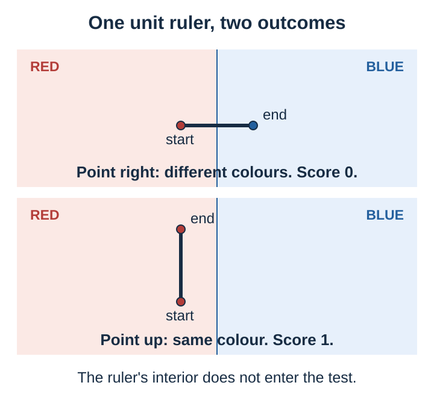
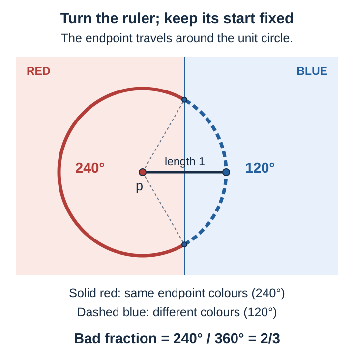
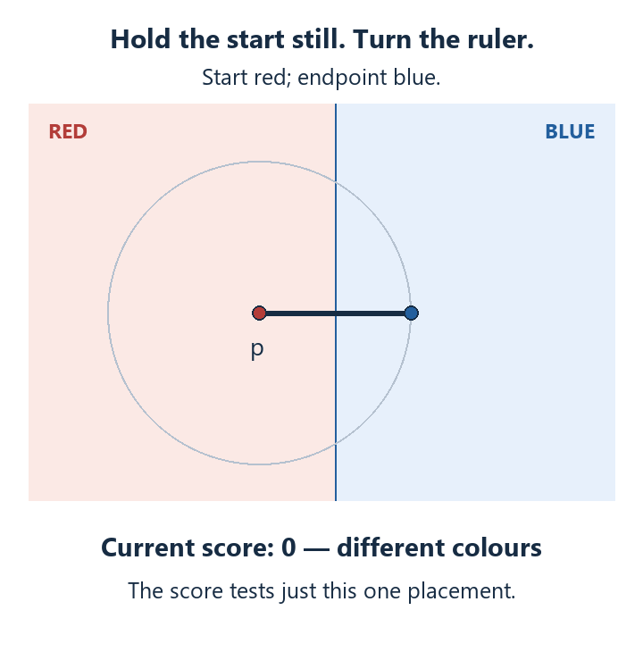

# Understanding the five-colour obstruction

**Start here.** This is the main reading path through our exposition. This first lesson builds one idea carefully: what a *weak measurable colouring* means, and why the proof needs it. You can give feedback on this page without following the supporting folders.

The supplied OpenAI proof, *The Euclidean plane is not five-colorable* (23 September 2026), rules out a proper five-colouring even when its colour classes are not measurable. Together with the classical seven-colouring construction, this gives $6\leq\chi(\mathbb R^2)\leq7$. It does not decide between six and seven. We are explaining that supplied result; our team's local contributions come later.

## 1. A rule that must hold everywhere

Imagine that every point of an infinite sheet receives one of five labels. Whenever two points are exactly distance one apart, their labels must differ.

Put a ruler of length one anywhere on the sheet. Its endpoints must have different colours. Turn it, slide it, move it far away: the same rule must always hold. This is what **proper colouring** means. The interior of the ruler is irrelevant; only its endpoints matter.

This is a graph-colouring problem: points are vertices and unit-distance pairs are edges. Crossing edges are allowed. We are not colouring the countries of a map.

To disprove five-colourability, assume such a colouring exists and derive a contradiction. But we cannot assume it looks like a picture made of coloured regions. Its colour classes could be too irregular even to have well-defined areas. Drawing smooth boundaries at the beginning would silently change the problem.

The proof therefore needs a bridge to objects that we can measure. Before looking at how that bridge is built, let us understand exactly what is on the other side.

## 2. Give one placement of the ruler a score

For a few minutes, use a deliberately simple picture: the left half-plane is red and the right half-plane is blue. Put the dividing line in blue. This is **not** a valid solution to the colouring problem. It is a practice example in which we can see every part of the test.

Place the ruler's starting point half a unit to the left of the dividing line.

Point it right: the start is red and the endpoint is blue. The pair obeys the rule. Give it a score of **0**.

Point it up: both endpoints are red. The pair breaks the rule. Give it a score of **1**.

Call this the **bad-pair score**. A score of 1 records a monochromatic unit pair; a score of 0 records a pair with different colours.

We now give names to the pieces we have already used. Let $p$ be the starting point, and let $u$ be the arrow from start to endpoint. Because the ruler has length one, $u$ is a unit vector. The endpoint is $p+u$. Write the score as $m(p,u)$:

$$
m(p,u)=
\begin{cases}
1 & \text{if the endpoint colours agree},\\
0 & \text{if they differ}.
\end{cases}
$$

So far there is no probability and no integration. We have tested one placement.

## 3. Keep the start still; turn the ruler

Now leave $p$ fixed and turn the ruler through a complete revolution. Its endpoint travels around a circle of radius one.

We are asking for the **fraction of directions that score 1**. That is an ordinary proportion: the total angle of the bad directions divided by one full turn.

In our picture, the endpoint reaches the blue side only while the ruler points within $60^\circ$ of directly right. That is a $120^\circ$ arc. For the other $240^\circ$, the endpoint is red like the starting point.

The bad fraction at this particular starting point is therefore

$$
\frac{240^\circ}{360^\circ}=\frac23.
$$

The two directions that land exactly on the dividing line do not affect this fraction: two individual angles occupy none of the full turn.

Watch one slow turn of the ruler

The animation pauses on the right-pointing, upward-pointing and left-pointing placements. Watch the **current score** switch between 0 and 1. The bad fraction $2/3$ describes the *whole turn*, not the score at a single instant.

Call the bad fraction $s(p)$. The letter reminds us that this number depends on the starting point. To write “average the score over all directions,” mathematicians use

$$
s(p)=\int_{S^1}m(p,u)\,d\sigma(u).
$$

Every symbol now has a job. $S^1$ is the circle of unit directions. The integral averages the 0s and 1s we see during the turn. The measure $\sigma$ gives one full turn total weight 1, so this is a **fraction**, not a total angle. In angle notation, $d\sigma=d\theta/(2\pi)$.

**Pause here:** a score concerns one ruler placement. A bad fraction concerns every direction from one fixed starting point. These are different measurements.

Check the angle calculation

Use coordinates with the dividing line at horizontal coordinate 0 and the starting point $p=(-1/2,0)$. A unit direction at angle $\theta$ is $u=(\cos\theta,\sin\theta)$. The endpoint's horizontal coordinate is $-1/2+\cos\theta$.

It is red precisely when $\cos\theta<1/2$. The boundary angles are $60^\circ$ and $300^\circ$; the red arc between them has length $240^\circ$.

## 4. Now let the starting point move

One fixed start is not enough to describe a colouring of the plane. Slide the pivot as well as turning the ruler.

There is no uniform way to choose a point from the entire infinite plane. Instead, choose a bounded disk $B$ as an **observation window**. Choose $p$ uniformly by area inside it, and independently choose a uniformly random direction.

Only the start must be in the window. The endpoint may lie outside it. The ruler still has exactly length one.

For each start $p$, we already know what to measure: its bad fraction $s(p)$. Average those fractions over the window. Call the result $P_B$:

$$
P_B=\frac{1}{|B|}\int_B s(p)\,dp.
$$

Here $|B|$ means the disk's area. The integral adds the bad fractions with area weights; dividing by $|B|$ makes the result an average between 0 and 1.

There are two equivalent ways to read $P_B$:

- Find the bad fraction at each starting point, then average over the window.
- Choose a random start and a random direction, then ask for the probability that the endpoint colours agree.

Both describe the same two-stage experiment.

Our red-and-blue practice picture makes this probability as large as it can be in some windows. Put a small observation disk well inside the red half-plane, far enough from the boundary that every unit ruler starting there stays red. Then **every** placement scores 1, so $P_B=1$.

For exact coordinates, a disk of radius $1/4$ centred at $(-2,0)$ works. Its rightmost starting point has horizontal coordinate $-7/4$; even a unit step directly right remains left of the dividing line.

Section 5 will require this probability to be zero in every window, so this one window already shows that the example is not a weak colouring. The earlier calculation $s(p)=2/3$ at just one point would not, by itself, establish that: one point has zero area in the outer average.

## 5. Weakness means this probability is zero in every window

A **weak measurable colouring** has measurable colour classes and satisfies

$$
P_B=0
\qquad
\text{for every bounded disk }B\text{ of positive area}.
$$

“Measurable” gives us the area-based language needed for these averages. The regions may still be very irregular; measurability does not give them smooth boundaries.

“Weak” changes the ruler rule. A proper colouring requires **every placement** to score 0. A weak measurable colouring requires the two-stage experiment to score 0 **with probability one**, in every observation window.

A test in a disk near us says nothing about a bad region far away. Requiring zero in **every** window makes the condition follow us wherever we move or enlarge it.

The zero average has force because all the scores are 0 or 1. There are no negative scores to cancel positive ones. If bad placements occupy positive measure in the position-and-direction experiment, their average is positive.

But **probability zero is not the same as impossibility**. Choosing a point uniformly from a disk has probability zero of hitting its exact centre, although the centre is there. Similarly, a weak colouring may have exceptional bad unit pairs.

For a concrete comparison, start with a measurable proper seven-colouring, such as the classical hexagon colouring with its boundary points assigned carefully. Pick a point $q$. Its unit circle is covered by the seven colours, so some colour $i$ occupies a positive fraction of that circle; in the hexagon colouring the circle passes through the interiors of several hexagons. Because the colouring is proper, $i$ is not $q$'s own colour. Recolour $q$ alone with colour $i$.

Properness is destroyed. Even the turning test of Section 3 now fails at this one start: $s(q)$ equals the fraction of the circle coloured $i$, which is positive.

Weakness survives. The original colouring was proper, so every new bad pair has $q$ as an endpoint. From any other start $p$, at most one direction points exactly at $q$, and a single direction occupies none of the full turn, so $s(p)$ is still 0. Only $s(q)$ is positive, and a single start has zero area, so $P_B=0$ in every window.

This is why the definition averages over starting points instead of demanding $s(p)=0$ at every $p$: a single exceptional start can have a positive bad fraction without changing any window's average.

We will say that something holds for **almost every** placement, or start, when the exceptions have **zero measure in this particular sampling experiment**.

A precision note about measurability

For the fixed-centre discussion, take the finitely many colour classes to be Borel sets forming a partition. Then the angular samples are measurable at every fixed $p$. The score $m(p,u)$ is jointly Borel in position and direction, so by Tonelli's theorem $p\mapsto s(p)$ is measurable and the window average $P_B$ is well defined. This loses no generality under manuscript Definition 1.2: any measurable colouring can be changed on a null set so that its classes are Borel, and such a change preserves weakness (next paragraph). With arbitrary Lebesgue-measurable representatives, the corresponding sections are guaranteed only for almost every centre.

Changing a colouring on a plane-null set preserves weakness. Cover that set by a Borel null set $N$. For each fixed $u$, the affected starts lie in $N\cup(N-u)$, still a null set. Integrating these zero-area sections over directions gives a null set of affected position-and-direction pairs.

## 6. Assemble the manuscript's formula

The long formula is a compact way to record the experiment we have built.

The only piece still hidden inside $m(p,u)$ is how to check whether the colours agree. Name the colour classes $A_1,\ldots,A_k$; each point belongs to exactly one class.

The **indicator** $1_{A_i}(p)$ is a yes-or-no test written as a number: 1 if $p$ has colour $i$, and 0 otherwise. For that one colour, multiply the two endpoint tests:

$$
1_{A_i}(p)\,1_{A_i}(p+u).
$$

The product is 1 only when **both** endpoints have colour $i$. If either endpoint fails the test, one factor is 0, so the product is 0.

Now add over all colours:

$$
m(p,u)=\sum_{i=1}^{k}1_{A_i}(p)\,1_{A_i}(p+u).
$$

If the endpoint colours agree, exactly one term is 1. If they differ, every term is 0. The sum reproduces our original bad-pair score.

Substitute this score into the two averages we have already built:

$$
P_B=
\frac{1}{|B|}
\int_B
\int_{S^1}
\sum_{i=1}^{k}1_{A_i}(p)\,1_{A_i}(p+u)
\,d\sigma(u)\,dp.
$$

Read **from the inside outward**: test the endpoints, average over the turn, then average over the starting window.

Because we require $P_B=0$, we can multiply by the positive area $|B|$ without changing the condition. We can also move the finite sum outside the integrals. We arrive at the manuscript's form:

$$
\sum_{i=1}^{k}
\int_B\int_{S^1}
1_{A_i}(p)\,1_{A_i}(p+u)
\,d\sigma(u)\,dp=0.
$$

The notation compresses three familiar actions: **test, turn, move**.

Match this wording precisely to the source

The manuscript tests origin-centred disks $B(0,R)$ for every $R>0$. This is equivalent to testing every bounded disk: any such disk lies in a sufficiently large origin-centred disk, and the score is nonnegative.

The relevant measure is **position times direction**. Choosing two independent plane points would give a different, useless test: the second would have probability zero of lying exactly one unit from the first, regardless of the colouring. Our construction builds the unit-distance constraint into the experiment by using $p+u$ with $u\in S^1$.

See the [manuscript](../Main/ResearchSnapshot/remote/attachments/here-are-three-files-ni5n/paper.pdf), Definition 1.2, and [Coloring.lean](../Main/ResearchSnapshot/local/work/encoding-integration/full-original/OAI/Geometry/PlaneColoring/Coloring.lean), <code>WeakColoring</code>. The formal definition uses almost-everywhere measurability and a product-almost-everywhere exclusion.

## 7. What this buys the proof

We wanted a rule about every unit pair. Why spend so long on a condition that allows exceptions?

Because the measurable replacement lets the proof talk about **how much of a small disk has a given colour**. For an arbitrary colour class, that question may have no answer. For a measurable class, it becomes a quantity we can estimate.

Here is the intuition for the next step. Suppose two locations are one unit apart, and around each location the same colour fills a fraction of a small centred disk that tends to 100% as the disk shrinks. A unit ruler placed near that pair has very little room to avoid landing in that colour at both ends. The supplied manuscript's Lemma 4.3 turns this into a positive-measure family of bad placements, contradicting weakness.

“Almost every” therefore still has geometric force. It can rule out an exact unit-distance relation between suitably robust locations.

Such locations are not rare. A classical theorem, Lebesgue's density theorem, says that for a measurable set, at all of its points outside a zero-area set, the fraction of a small centred disk occupied by the set tends to 100% as the disk shrinks. So for any tolerance, say 99%, every small enough disk centred at such a point is at least 99% filled, although it need not be completely filled. This is a standard result of real analysis, not part of the supplied manuscript or our team's work. The next lesson will develop this step: what this property means precisely, and why it makes the bad placements occupy positive measure.

One large task remains before we can use any of this: our original hypothetical proper colouring might not be measurable. We cannot simply insert its colour classes into the integrals.

The supplied **transfer theorem** builds a new weak measurable colouring from the existence of an unrestricted proper colouring, using the same finite number of labels. This is a substantial analytic result. It is not ordinary smoothing, and the new colouring is not asserted to agree with the original one.

The overall logic is now visible:

1. If a proper five-colouring existed, the transfer theorem would produce a weak measurable five-colouring.
2. The geometric part of the proof shows that no weak measurable five-colouring exists.
3. Therefore no proper five-colouring exists.

That is the role of the definition we have just built.

## A place to stop and respond

Before moving on, try saying what each zero means:

- $m(p,u)=0$;
- $s(p)=0$;
- $P_B=0$.

Compare your reading

- This one placement has different endpoint colours.
- From this fixed start, almost every direction gives different endpoint colours.
- For almost every start in this window, almost every direction gives different endpoint colours.

The bad fractions $s(p)$ are never negative, so their window average can be 0 only if $s(p)=0$ for every start in the window outside a zero-area set. The third statement can therefore tolerate exceptional starting points; it does not imply the second at every $p$. The recoloured point $q$ in Section 5 is exactly such an exception. All three use the same unit ruler, but they quantify over different things.

**Feedback on this page:** name the first sentence where you had to take something on trust, or the first picture that did not help you make a new inference. Section numbers give us a stable way to discuss it. The next lesson, added to this page, will develop the density step previewed in Section 7.

---

The rest of the proof: a technical map for later reading

The following is a compact orientation, with source pointers. It runs ahead of the teaching sequence above; it is not required to complete this first lesson.

## Bridge one: extracting measurable structure

First restrict the assumed proper colouring to the countable algebraic plane. Average its translates and algebraic rotations to produce a symmetry-invariant probability law on labelings. Randomization gives symmetry, but does not by itself give a measurable plane colouring.

The next step is the deep analytic part. Translation operators acting on square-integrable random variables have a spectral description by characters: functions that turn addition into multiplication by complex numbers of modulus one. Ordinary characters have the familiar form $z\mapsto\exp(i\xi\cdot z)$. The discrete algebraic plane also admits less regular characters.

The manuscript's Theorem 2.3 proves a rigidity result: a rotation-invariant probability law concentrated away from ordinary characters must be Haar probability. Sections 2–3 establish this using compact factors, conditional averaging, and Fourier identities. Consequently the irregular remainder has zero correlation under every nonzero algebraic translation.

Projecting each colour indicator onto the ordinary-character part preserves its nonnegativity and preserves the sum of all coordinates as one, because this projection is conditional expectation. Removing the irregular remainder preserves the zero correlations at unit translations. The remaining translation action extends continuously to the real plane and yields jointly measurable fields.

For a suitable sample, select the least label whose field coordinate is positive wherever the coordinates sum to one. Assign a fixed default label on the remaining plane-null set, so the colouring is defined everywhere. Two selected equal labels would make the corresponding product positive, which the zero-correlation statement forbids almost everywhere. Changing the null set does not affect weakness. This produces the required weak measurable colouring. The explanation here identifies what each analytic ingredient accomplishes; it is not an independent reconstruction of the compact-factor argument. See manuscript Sections 2–4, especially Theorem 2.3 and Proposition 4.2.

## A worked lemma: density turns “almost always” into exact exclusion

A density-one point of $A_i$ is a point around which the fraction of a sufficiently small disk occupied by $A_i$ tends to one. Manuscript Lemma 4.3 says two density-one points of the same class cannot be exactly one unit apart.

Suppose otherwise that $y=x+u$, with both points having density one in $A_i$. Perturb $x$ uniformly inside a disk of radius $h$, and independently perturb $u$ inside a small arc with $|u'-u|<h$. The new endpoint $x'+u'$ remains within $2h$ of $y$.

The chance that $x'$ misses $A_i$ tends to zero. The distribution of $x'+u'$ has density at most $1/(\pi h^2)$, so its chance of missing $A_i$ is bounded by the area missing from the radius-$2h$ disk divided by $\pi h^2$, which also tends to zero. Hence both endpoints lie in $A_i$ with positive probability. Their distance is still exactly one. The sampling law is the normalized restriction of position-times-direction measure to a disk times a positive-measure arc, so positive probability here means a positive-measure set of forbidden unit pairs. This contradicts the weak condition.

Almost every plane point is a density-one point of its class. Any fixed finite configuration can be translated entirely into this full-measure set, since only finitely many null sets must be avoided. The lemma then properly colours that finite graph. Graph compactness assembles finite satisfiability into a proper colouring of the whole plane. This proves the converse direction of Theorem 1.3; the final five-colour contradiction only needs the forward direction.

## Bridge two: manufacture interfaces instead of assuming them

At a fixed centre, inspect colour proportions around nearby circles whose radii approach one. Weak limits of these angular samples define a **palette**: the labels that can persist at a direction. This is a measure-based limiting object, not simply the colour of the point on the circle. Section 5 proves that almost every such palette has at most two labels in the five-colour setting.

Section 6 organizes substantial transitions into a graph on the colour labels. The centres where this graph contains a cycle form a closed, locally finite set. Circle-averaging estimates control the irregularity. In Section 7, smoothed colour indicators become continuous maps into the complete graph on five labels, apart from controlled holes. Away from cyclic centres the relevant graph is a forest, allowing holes to be filled. A planar topological obstruction forces a nontrivial loop near a cyclic centre.

A simple cycle in that loop supplies compact connected sets $K_j$ sharing a centre $x$, each carrying a pair of forbidden labels. Their exclusion region is

$$
\Delta(K)=\{z:\min_{q\in K}|z-q|<1<\max_{q\in K}|z-q|\}.
$$

Both labels associated with $K_j$ are absent almost everywhere in $\Delta(K_j)$. This conclusion requires the analytic interface construction; connectedness alone does not establish a two-label prohibition. See manuscript Section 7 and [AngularBoundary.lean](../Main/ResearchSnapshot/local/work/encoding-integration/full-original/OAI/Geometry/PlaneColoring/AngularBoundary.lean), `Straddle` and the support-exclusion lemmas.

For geometric intuition, take $K$ to be a short segment. A point in $\Delta(K)$ is less than one from some part of the segment and more than one from another part. Distance varies continuously along the segment, so somewhere it equals one. More generally, the continuous image of any connected $K$ is an interval, giving the same contact conclusion without assuming a path inside $K$.

For an accurate drawing, the minimum distance is to the **whole segment**, computed by perpendicular projection with endpoint clamping. The maximum occurs at an endpoint. The region is the open radius-one capsule about the segment, restricted to points more than one from at least one endpoint. Points strictly inside one endpoint disk and strictly outside the other closed disk give a sufficient subset. They omit contacts created by the segment interior; using a literal symmetric difference also mishandles equality at the disk boundary. This is a useful visualization of why the word “straddle” captures a robust unit-distance contact.

## Why the extracted cycle cannot exist

A simple cycle on five labels has length three, four, or five. The manuscript's Section 8 eliminates all three.

For length five, approaching directions in the continua restrict allowed labels on the inner and outer sides of the unit circle. Six directions spaced by $60^\circ$ must obey incompatible finite transition rules. Length four forces antipodal direction pairs and a contradictory parity rule. Length three forces alternating sectors for the two labels outside the cycle. The resulting open region uses only the three cycle labels almost everywhere; a certified placement of the seven-vertex Moser obstruction inside that region contradicts three-colourability, with exceptional null sets handled in the proof.

The Lean assembly packages this geometry through continuous full approximations and a large-connected-region obstruction, rather than literally following the manuscript's final narrative line by line. Its root [Five.lean](../Main/ResearchSnapshot/local/work/encoding-integration/full-original/OAI/Geometry/PlaneColoring/Five.lean) states `no_measurable_weak_five_coloring` and then `no_proper_five_coloring`, whose hypothesis contains no measurability requirement.

## What our team adds, and what remains open

Our simplification work replaces part of the strict-state machinery by three-centre arguments. The latest inspected [research status](../Main/ResearchSnapshot/local/outputs/RESEARCH-STATUS.txt), saved at 10:25 Pacific on 14 November, reports separate fixed- and moving-centre passes but an ongoing integrated rebuild. It does not yet justify declaring the full replacement integrated.

The team's local **CC60** theorem says that a finite family of actual approaching continua at one common centre, with signed approach directions in a closed cone of width at most $60^\circ$, cannot jointly exclude all but two labels. It assumes the actual spatial-support exclusions and a weak measurable colouring. It is generic in the number of colours and includes equality at $60^\circ$. The [cone packet](../Main/ResearchSnapshot/local/outputs/cone/REPORT.txt) records successful Lean checks and standard-only axiom audits; its [independent referee report](../Main/ResearchSnapshot/local/outputs/ASTRA-CONE-REFEREE.txt) explains the geometric hypotheses.

CC60 is a local obstruction, not an unrestricted six-colour impossibility theorem. Finite palette searches likewise test stated relaxations, not all plane colourings. The team's work has not improved the supplied $6\leq\chi\leq7$ bound or constructed a global six-colouring. This walkthrough checks source statements and selected arguments; it does not independently reverify the entire supplied proof, its full Lean closure, or novelty priority of the local results.

Sources, attribution and review scope

The [manuscript](../Main/ResearchSnapshot/remote/attachments/here-are-three-files-ni5n/paper.pdf), Theorems 1.1–1.4, states the supplied result and transfer theorem. The [source bundle](../Main/ResearchSnapshot/remote/attachments/here-are-three-files-ni5n/hadwiger-nelson-lean-review-bundle.md) identifies OpenAI commit <code>fd4aeeb2ee4fc729c18d98444fed42fd0529eeeb</code>, Lean 4.34.1, and mathlib commit <code>d13f23b723b8a846827a245b89c10fc7d3f11612</code>. The [source map](SourceMap.md) gives declaration names and distinguishes supplied results from team contributions.

The exposition director prepared the initial lesson with an [Astra source audit](Reviews/WeakColouringLesson-Astra.md). Claude then led the final editorial integration, using focused reader reviews and two independent Claude checks. These are bounded checks of this explanation, not independent verification of the entire supplied proof. Figures illustrate the explicit half-plane example and the sampling definition; they do not depict a valid colouring.

