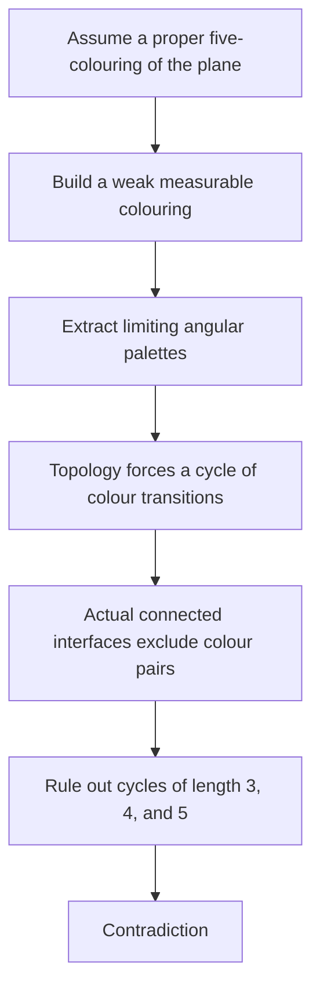

# Understanding the Mathathon mathematics

The aim is to make the proof something a reader can reason with: see the geometric object, understand the need for a lemma, and follow the exact implication it supplies. Our first synthesis focuses on the supplied proof that the plane is not five-colourable, and on the team's subsequent local results.

Start with [the proof walkthrough](ProofWalkthrough.md). It follows the two difficult bridges: from an arbitrary colouring to measurable structure, and from measurable structure to geometric contradictions. The [source map](SourceMap.md) gives exact statements and locators.

The arrows summarize the supplied argument, not new theorems proved by this guide. The measurable replacement requires a substantial analytic theorem; the geometric interfaces are constructed, not assumed to be smooth boundaries.

| Explore | What it makes understandable |
| --- | --- |
| [Unit-distance contact](Tools/UnitDistanceContact.md) | Why a connected set creates a robust region of exact unit-distance contacts; includes a movable-point model |
| [Three centres, one remaining label](ThreeCentres.md) | A complete palette contradiction, and the geometric hypotheses that make its simple set argument apply |
| [Curvature and the four-label obstruction](Progress/2026-11-14-geometry-update.md) | Two new independently reviewed paper arguments and why their conclusions remain local |
| [From paired interfaces to the obstruction](Progress/2026-11-14-paired-configuration.md) | How six explicit palette rows connect one exact geometric configuration to the four-list contradiction |
| [First cross-project briefing](Progress/2026-11-14-first-briefing.md) | What the team has learned, with evidence and the limits of each result |
| [Reader checks](ReaderChecks.md) | Six questions that test whether the mechanisms and qualifications make sense |
| [Completed Claude reader reviews](Reviews/Claude-FirstReview.md) | Checked geometry and measure-theoretic clarifications incorporated into the walkthrough |
| [First showcase](Showcases/2026-11-14-01.md) | A short route through the first teaching materials |

Hourly showcases will demonstrate newly built or improved explanations. Separate mathematical progress briefings are reserved for major contributions. Between showcases, the priority is a coherent synthesis of the proof, supported by worked examples and independent reader reviews.

**Attribution.** The September 2026 OpenAI manuscript and formalization are the starting material. Three Astra agents drafted and checked these explanations; two focused Claude Opus 5.5 reviews improved the geometry and measure-theoretic wording. These bounded reviews do not independently verify the entire supplied proof. The exposition director checks the integrated claims and keeps source pointers. [Mathathon's official overview](https://competition.sair.foundation/competitions/mathathon/overview) describes understanding and explanatory work as central objectives.
