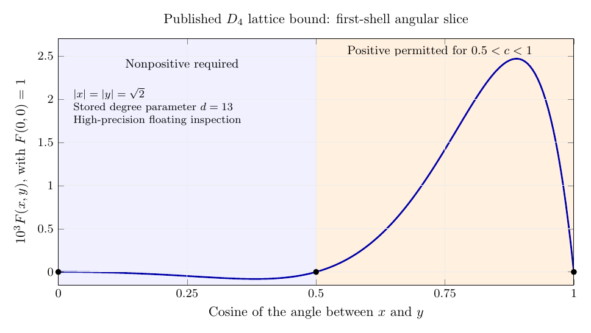

# Feasibility of an exact auxiliary function in dimension 4

14 November 2026

An exact **three-point lattice** certificate for $D_4$ is a plausible extension
of the analytic ideas behind Viazovska's work. It requires a function of two
four-dimensional vectors that depends essentially on their angle. Searching
for an ordinary radial four-dimensional magic function cannot succeed: the
two-point Cohn–Elkies bound is provably nonsharp in dimension 4. Searching in a
fixed finite polynomial–Gaussian space cannot attain the exact lattice bound
either, although such spaces provide strong approximations.

The principal unresolved task is to construct an angle-dependent function,
beyond finite real Gaussian expansions, with two global sign properties. The evidence supports
investigating this task; it does not establish that a solution exists. This
study supplies reproducible finite diagnostics, proofs of several restrictions
on the function class, and an explicit example showing why arithmetic zeros
and Fourier positivity alone do not solve the problem.

The most useful concrete finding is a connection between angular harmonics
and radial Fourier transforms in dimensions $4+2\ell$. It permits using
8- and 24-dimensional ingredients, but also proves that adding only one
nonconstant angular harmonic cannot work. Inspection of the published
degree-13 solution confirms substantial cooperation between several angular
sectors. A promising next class is therefore a coupled angular expansion
with transform-controlled, nonpolynomial radial profiles.

## 1. The question that can reasonably be pursued

Write

$$
D_4=\{x\in\mathbb Z^4:x_1+x_2+x_3+x_4\text{ is even}\}.
$$

Its shortest nonzero vectors have length $\sqrt2$ and its covolume is $2$.
Balls of radius $1/\sqrt2$ centered at its points therefore have density

$$
\delta(D_4)=\frac{\operatorname{vol}(B^4_{1/\sqrt2})}{2}
=\frac{\pi^2}{16}=0.616850275068\ldots.
$$

$D_4$ is already known to be optimal among lattices. An exact analytic
certificate would supply a new explanation of that fact. It would not, by
itself, establish optimality among arbitrary packings.

These are three different research objectives:

| Objective | Assessment |
|---|---|
| An exact ordinary Cohn–Elkies certificate at the $D_4$ density | Ruled out |
| An exact three-point lattice certificate | Open and supported by strong numerical evidence |
| A Fourier-analytic proof for every four-dimensional packing | Requires a stronger argument beyond this lattice theorem |

For the first row, Li's Theorem 7.1 gives a strict lower bound
$0.12914461$ on the two-point optimum in **center-density units**, exceeding
both the $D_4$ value $1/8$ and an independently known upper bound on the actual
packing optimum. Center density is converted to packing fraction by multiplying
by $\pi^2/2$. This obstruction concerns the optimization method itself, not
the adequacy of currently known modular forms.
[Li, §7](https://arxiv.org/html/2206.09876v3#S7).

The appropriate replacement here is the lattice theorem and conjecture of
Cohn, de Laat, and Salmon. Their theorem for unrestricted packings is different;
in particular, its positive-semidefinite kernel condition must not be substituted
for the Fourier positivity condition below.
[Three-point bounds, Theorems 1.1 and 1.4](https://arxiv.org/html/2206.15373#S1).

## 2. Exact certificate and normalization

Use the full eight-dimensional Fourier transform

$$
\widehat f(\xi,\eta)=\int_{\mathbb R^4\times\mathbb R^4}
f(x,y)e^{-2\pi i(x\cdot\xi+y\cdot\eta)}\,dx\,dy.
$$

Set

$$
S=\{(x,y):|x|,|y|,|x+y|,|x-y|
\in\{0\}\cup[\sqrt2,\infty)\}.
$$

The desired real Schwartz function satisfies

$$
f(0,0)=1,\qquad\widehat f(0,0)=4,
\qquad\widehat f\ge0\text{ everywhere},
\qquad f\le0\text{ on }S\setminus\{(0,0)\}.
$$

It would give the lattice density bound

$$
\operatorname{vol}(B^4_{1/\sqrt2})
\sqrt{\frac{f(0,0)}{\widehat f(0,0)}}
=\frac{\pi^2}{16}.
$$

Here is the short reason. A lattice $L$ with minimum length at least $\sqrt2$
has $L\times L\subset S$, because $x+y$ and $x-y$ remain lattice vectors.
Writing its covolume as $V$, Poisson summation gives

$$
f(0,0)\ \ge\sum_{x,y\in L}f(x,y)
=V^{-2}\sum_{\xi,\eta\in L^*}\widehat f(\xi,\eta)
\ \ge V^{-2}\widehat f(0,0).
$$

Thus $V\ge\sqrt{\widehat f(0,0)/f(0,0)}=2$. This proves the stated density
bound for lattices. The closure step explains the restriction to lattices.

Applying the same chain to $D_4$ gives equality throughout. Consequently

$$
f(x,y)=0\quad((x,y)\in(D_4\times D_4)\setminus\{(0,0)\}),
$$

$$
\widehat f(\xi,\eta)=0\quad
((\xi,\eta)\in(D_4^*\times D_4^*)\setminus\{(0,0)\}).
$$

These zero conditions follow from the signs and normalization. They do not
replace them. The origin exceptions are essential; their omission in the
printed zero sets of Conjecture 6.1 is a typographical inconsistency with its
normalization. [Conjecture 6.1 and discussion](https://arxiv.org/html/2206.15373#S6.SS2).

## 3. The correct symmetry retains an angular variable

Simultaneous orthogonal transformations, swapping the vectors, and changing
either vector's sign preserve the problem. Averaging over these compact
symmetries allows the form

$$
f(x,y)=\Phi(u,v,t),\qquad
u=|x|^2,\quad v=|y|^2,\quad t=x\cdot y,
$$

with

$$
u,v\ge0,\quad t^2\le uv,\qquad
\Phi(u,v,t)=\Phi(v,u,t)=\Phi(u,v,-t).
$$

The sign condition concerns $u,v,u+v+2t,u+v-2t$, each of which must be zero
or at least $2$. It includes axes and exact diagonals; these boundary pieces
must not be dropped by a numerical implementation.

For $u,v\ge2$, the open region exempt from the nonpositivity condition is

$$
0<u+v-2|t|<2.
$$

Some positive values in this region are **necessary** for exactness. Otherwise
the function would have the stronger signs of the disjunctive-product bound,
whose optimum is the square of the ordinary two-point optimum. Thus a viable
certificate must exploit pairs whose sum or difference is short but nonzero.
At $u=v=2$, these are the angular intervals $1<|t|<2$, while the exact
diagonal and antidiagonal $|t|=2$ again require nonpositivity.

If $\Phi$ is independent of $t$, one can choose perpendicular representatives
at any fixed lengths. The sign condition then holds for every pair of vectors
of those lengths, making the function feasible for the disjunctive-product
problem. Its lattice objective is at least $\Delta_2(4)$, strictly above
$\pi^2/16$. This rules out **all** angle-independent functions, not just single
tensor products. The proof and normalization are in the
[theory assessment](notes/theory-assessment.md), using
[Cohn–de Laat–Salmon, Proposition 4.7](https://arxiv.org/html/2206.15373#S4.SS1).

An especially tempting mistake is to impose full radial symmetry in
$\mathbb R^{4+4}$. The axis condition would then make $f$ nonpositive outside
the eight-dimensional ball of radius $\sqrt2$. Applying Poisson summation on
$E_8$ forces $f(0)\ge\widehat f(0)$, contradicting $1<4$. The fact that the
auxiliary function has eight real variables does not allow direct reuse of
Viazovska's radial $E_8$ certificate.

Nor should one additionally impose positive semidefiniteness on $f(x,y)$ as
a kernel on $\mathbb R^4$. That would force $f(x,x)=0$ when $|x|\ge\sqrt2$;
kernel Cauchy–Schwarz would then force $f(x,y)=0$ for every $y$ at such $x$.
Together with the required full Fourier positivity, this again falls under
the excluded product bound. The two notions of positivity serve different
theorems.

## 4. Why a finite Gaussian search cannot finish the proof

Suppose

$$
f(z)=\sum_{j=1}^N P_j(z)e^{-z^TA_jz},
$$

with polynomial $P_j$ and real positive-definite $A_j$. Choose a nonzero
$v\in D_4$ and restrict to $z=s(v,0)$. Group equal decay rates to obtain

$$
f(sv,0)=\sum_{k=1}^M q_k(s)e^{-a_ks^2},\qquad a_1<\cdots<a_M.
$$

Exactness requires this expression to vanish at every positive integer $s=m$.
Multiplication by $e^{a_1m^2}$ shows $q_1(m)\to0$, since the remaining terms
decay exponentially. A nonzero polynomial cannot do that. Induction eliminates
every $q_k$, forcing $f(0,0)=0$, a contradiction.

Therefore no finite polynomial–Gaussian expansion with real Gaussian
quadratic forms can attain the target. This elementary obstruction does not
exclude convergence of increasingly large finite models, infinite Hermite
expansions, or modular contour integrals. It also does not assert anything
about arbitrary complex oscillatory Gaussian families.

There is a stronger obstruction to replacing the finite sum with a real
Gaussian integral. Suppose, in the simultaneously invariant matrix form,

$$
f(X)=\int_{A>0}e^{-\pi\operatorname{tr}(AX^TX)}\,d\mu(A),
$$

where $X=[x\ y]$ and $\mu$ is any finite-total-variation complex measure on real
positive-definite matrices. Every positive even integer $2m$ occurs as a
squared norm in $D_4$, by the four-square theorem and parity. The required
axis zeros therefore give $\int q^m\,d\mu=0$ for all $m\ge1$, where
$q=e^{-2\pi A_{11}}\in(0,1)$. But the polynomials
$1-(1-q)^N$ have zero integral and converge boundedly to $1$. Dominated
convergence forces $f(0)=\int1\,d\mu=0$, contradicting the normalization.

The [full proof](notes/theory-assessment.md) also covers uniformly bounded
polynomial factors with finite-total-variation coefficient measures.
Thus even infinitely many signed real Gaussian weights do not suffice under
these absolute-convergence assumptions. Complex Gaussian **parameters**,
unbounded polynomial degree, or a different regularized representation are
substantive changes of class; complex scalar weights alone are not.

## 5. What the numerical evidence does and does not show

Cohn–de Laat–Salmon's published lattice upper bounds approach the target
rapidly:

| Published degree parameter $d$ | Lattice upper bound |
|---:|---:|
| 8 | 0.619935194 |
| 9 | 0.617926232 |
| 10 | 0.617173341 |
| 11 | 0.616946076 |
| 12 | 0.616879313 |
| 13 | 0.616858175 |
| Exact $D_4$ density | 0.616850275068… |

The degree-13 gap is approximately $7.90\times10^{-6}$ in packing fraction,
or $1.28\times10^{-5}$ relative to the target. These are rigorous **published**
bounds, not optimizations rerun during this sprint.
[Table 6.2](https://arxiv.org/html/2206.15373#S6.SS2).

There are two logically distinct gaps between this evidence and an exact
formula: proving that the infimum equals the target, and proving that the
infimum is attained in the required function class. Increasing polynomial
degree alone settles neither.

The new computation in this folder is deliberately narrower. It enumerates
$D_4$ shell-pair Gram data, implements the Fourier action on symmetric
polynomial–Gaussian functions using rational arithmetic, and checks finite
systems of required values and first derivatives. It rejects several small
finite spaces before any sign optimization is attempted. Details and generated
tables are in the [computational assessment](notes/numerical-assessment.md).

There are 409 enumerated vectors through squared norm 12 and 101 canonical
Gram triples. The Fourier implementation passes 388 exact algebra checks.
Twenty-four saved augmented-matrix minors have been independently verified
modulo a prime. In particular, the finite constraints exclude Gram degree at
most 9 at the fixed Gaussian width, using shells through squared norm 6 and
appropriate stationary-zero conditions. A separate leading-term sign argument
also rules out degree 10: a nonzero globally feasible polynomial must have
odd highest Gram degree. These are exact diagnostics, not a new density bound.

The code's `gram_degree` is ordinary total degree in $(u,v,t)$; Cartesian
degree is twice this. The paper's degree parameter $d$ permits Gram degree
$2d$, so its $d=13$ calculation must not be compared to code degree 13 as if
they were the same space.

We also reconstructed one angular slice directly from the authors' archived
$d=13$ solver output. At $|x|=|y|=\sqrt2$, write $c=\cos\angle(x,y)$ and
normalize the function to $F(0,0)=1$. Selected values are:

| $c$ | Reconstructed $F(x,y)$ | Sign-region interpretation |
|---:|---:|---|
| 0.25 | $-4.713\times10^{-5}$ | Nonpositivity required |
| 0.50 | $-5.316\times10^{-14}$ | Lattice angle; close to zero |
| 0.75 | $1.419\times10^{-3}$ | Positive values permitted |
| 0.90 | $2.454\times10^{-3}$ | Positive values permitted |
| 1.00 | About $10^{-55}$ | Exact diagonal requires nonpositivity; numerical zero |

The permitted positive interval is strictly $0.5<c<1$; the exact diagonal
at $c=1$ belongs to the nonpositive region again. The angular average of this
slice is approximately $3.8874\times10^{-4}>0$. Thus independent rotation
averaging would remove exactly the useful behavior.

The sum-of-squares parametrization explains where the positive cap comes
from. One sign-generating factor is

$$
(|x+y|^2-2)(|x-y|^2-2)=(u+v-2)^2-4t^2.
$$

It is nonnegative when both sum and difference meet the exclusion radius,
but negative when one is short. On this shell it is $4(1-4c^2)$. A negative
multiple of this factor times a square therefore permits precisely the
observed sign change. The exact diagonals require additional constraints;
this factor alone would not satisfy the theorem. Preserving this geometry
while changing the analytic basis is a concrete construction strategy.

This is **high-precision inspection of stored floating-point output**, not a
new rigorous certification. Evaluations at 60 and 90 decimal digits agree
closely, and the reconstructed origin value matches the stored objective;
these checks do not certify the original solver error or the continuum signs.
The extracted objective reproduces the published density
$0.61685817494\ldots$. Byte ranges, checksums, basis reconstruction, values,
and angular coefficients are supplied in the
[reproduction instructions](computation/UPSTREAM_REPRODUCTION.md).

## 6. Zeros and Fourier positivity can coexist without the crucial sign

The [cardinal near-certificate](notes/cardinal-near-certificate.md) gives an
explicit construction with all of the following properties:

$$
F\in\mathcal S(\mathbb R^8),\quad F(0)=1,\quad\widehat F(0)=4,
\quad\widehat F\ge0,
$$

together with every prescribed zero on $D_4^2\setminus\{0\}$ and its dual.
Yet at an explicit axis point $z_0\in S\setminus\{0\}$ it satisfies

$$
F(z_0)\ge\frac1{5\pi}>0.
$$

The construction uses smooth compactly supported frequency masks and lattice
coordinates. It is not a proposed packing certificate. Its purpose is to show
that even exact arithmetic interpolation and full Fourier positivity leave a
substantial continuum sign problem.

## 7. Analytic classes worth exploring

A useful family must retain angular information, accommodate infinitely many
zeros, and have a tractable Fourier transform. Two related directions deserve
attention.

**Matrix-Gaussian integrals.** With $X=[x\ y]$ and a complex symmetric
$2\times2$ matrix $Z$ having positive-definite imaginary part, set

$$
K_Z(X)=e^{\pi i\operatorname{tr}(ZX^TX)}.
$$

Its exact Fourier transform is

$$
\widehat K_Z(Y)=\det(-iZ)^{-2}
e^{\pi i\operatorname{tr}(-Z^{-1}Y^TY)}.
$$

The off-diagonal entry of $Z$ couples $x$ and $y$. This makes matrix contour
integrals a natural language for Fourier symmetry and genus-two theta
relations. The [theory note](notes/theory-assessment.md) derives the exact
$D_4$ inversion and isodual scaling identities.

This is an analytic starting point, not an existence argument. The real
finite-measure version, even with signed weights, is ruled out in §4.
Complex contours or regularized expressions require separate proofs of
convergence and Fourier nonnegativity. Also, the paper's
genus-two observation concerns **dual** summation formulas for a strengthened
problem; it does not provide a primal magic function. Full
$\mathrm{GL}_2(\mathbb Z)$ symmetry is absent from the original four-length
region.

**Fourier eigenfunctions with angular factors.** There are already explicit
modular Fourier eigenfunctions in dimension 4. Lautzenheiser's construction
provides a genuine special-function ingredient, but its value at the origin
is zero and it is not Fourier-positive. It is therefore not a certificate.
[Lautzenheiser, Proposition 1](https://arxiv.org/html/2208.14534v3).
Combining radial ingredients must introduce angular dependence; a sum of
products depending only on $|x|$ and $|y|$ remains in the excluded class.

There is a precise way to introduce it. Let $r=|x|$, $s=|y|$, and

$$
Z_\ell(x,y)=(rs)^\ell U_\ell\!\left(\frac{x\cdot y}{rs}\right),
$$

extended polynomially across the axes. Here $U_\ell=C_\ell^1$ is the
appropriate Gegenbauer polynomial. Bochner's identity gives

$$
\mathcal F[Z_\ell a(r)b(s)]
=(-1)^\ell Z_\ell(\xi,\eta)
(\mathcal F_{4+2\ell}a)(|\xi|)
(\mathcal F_{4+2\ell}b)(|\eta|).
$$

Thus angular degree $2$ uses radial dimension $8$, and degree $10$ uses
radial dimension $24$. This is a genuine transform identity, not an analogy.
[Stoller, §2](https://arxiv.org/html/2002.11627).

However, an angle-independent base plus **any one** nonconstant even angular
sector still cannot beat the two-point bound: that Gegenbauer polynomial has
a zero at a safe angle, which forces the base to have the product signs.
Some larger collections are excluded by a positive quadrature supported on
safe angles. These restrictions are proved in the
[harmonic-lift note](notes/harmonic-lift.md).

Several coupled sectors escape those particular obstructions. For example,
on the first primal shell the exact local profile

$$
q(c)=c^2(c^2-1/4)(1-c^2)=\frac{U_0+2U_2-U_6}{64}
$$

has the required signs and lattice zeros while having positive angular
average. A separate nonnegative first-dual-shell profile is

$$
\widetilde q(c)=c^2(c^2-1/4)^2(1-c^2)
=\frac{2U_0+3U_2+U_4-U_6-U_8}{256}.
$$

These are independently verified **local shapes**, not a Fourier-transform
pair or a global certificate. They suggest testing sectors $0,2,4,6,8$ with
radial ingredients in dimensions $4,8,12,16,20$. The published primal slice
has coefficient signs $(+,+,+,-,-)$ in these five sectors and also uses
higher sectors. This is a heuristic reason to retain several interacting
sectors, not a relation between the two local profiles. Restricting ingredients to dimensions 8
and 24 alone has no demonstrated advantage.

Existing radial interpolation theorems provide useful tools, but tensorizing
them introduces partial-Fourier data in addition to the full transform. Lattice
Gram-node values do not automatically supply those data or their compatibility.
The [literature audit](notes/literature-audit.md) records this gap, relevant
2025 radial interpolation work, and the distinction between sampling and free
interpolation.

## 8. A research plan with falsifiable milestones

1. **Extend the observed angular structure across radii and degrees.**
   This study inspects one published first-shell slice. Next extract values
   and jets near several Gram triples, reproduce additional degrees, and test
   whether the sector coefficients stabilize. Evaluation precision stability
   at one degree is not convergence of a sequence of certificates.
2. **Choose a Fourier-stable infinite family.** Use angular harmonic factors
   or genuinely complex matrix-Gaussian integrals, first checking the angular
   quadrature obstructions and proving transform identities and regularity.
3. **Enforce both lattice and dual interpolation.** Include axes, diagonals,
   interior first derivatives, and symmetry. A numerical fit at a few shell
   points is a diagnostic, not a certificate.
4. **Prove the two continuum signs.** This is the decisive milestone. It needs
   an analytic inequality, a positive representation, or a validated compact
   computation combined with rigorous tail estimates.
5. **Keep the unrestricted problem separate.** A successful lattice function
   would settle the exact-function conjecture and give a new lattice proof.
   An unrestricted proof requires a theorem whose hypotheses apply to arbitrary
   packing centers.

A useful negative result would rule out a substantially larger infinite
angular class or prove a strict dual gap for the lattice program. Failure of
one finite model does neither. A useful positive result would identify stable
angular interpolation data or prove one of the two global inequalities for a
nontrivial candidate with the correct normalization.

## 9. Assessment

The project has a mathematically well-defined and credible dimension-4 target,
but the promising target is narrower than solving unrestricted sphere packing.
Its most important feature is **angular coupling**. Existing modular
eigenfunctions and genus-two Fourier identities provide tools for expressing
that coupling; they do not yet resolve the global signs.

The next investment should be in understanding angular structure and exact
interpolation, followed by positivity. A search restricted to scalar radial
functions, angle-independent tensor products, or a fixed finite Gaussian
expansion has already lost the features an exact solution requires.

The mathematical deductions in this folder have been independently checked
by the research and review agents; no novelty or Lean verification is claimed.
The exact finite algebra, the high-precision source inspection, and the open
analytic proposals are distinguished in the [claim ledger](CLAIMS.md).
