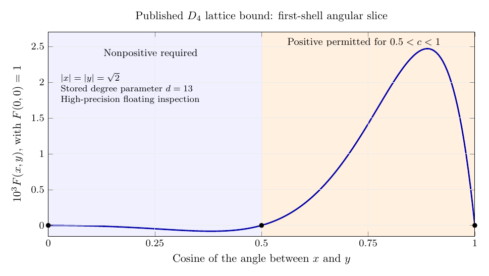

# Inspecting the published dimension-4 solution

The published degree-13 lattice solution contains the angular behavior that
the theoretical analysis predicts: near the shortest-vector shell it is
negative at the permitted packing angles and substantially positive in the
excluded caps. This is visible in the actual archived solver output, after
reconstructing its sum-of-squares polynomial at high precision.

The source is the authors' [MIT dataset](https://hdl.handle.net/1721.1/143590),
specifically the lattice code and stored output for dimension 4. The calculations
here inspect floating-point data. They do not rerun the optimizer or the authors'
Arb verification, and the resulting samples are not global sign certificates.



The curve is even in the cosine, so only the nonnegative half is shown.
Nonpositivity is required for $0\le c\le1/2$ and again at the exact diagonal
$c=1$; positivity is permitted for $1/2<c<1$. The dots mark lattice angles
where the stored output is numerically close to zero. Their displayed zero
height does not assert that a floating-point residual is exactly zero.

## What was reconstructed

The archived code uses minimum length $r=1$ and $\widehat g(0,0)=1$,
with objective $g(0,0)=4.000102455$. Its variables are ordered
$(t,u,v)=(\langle x,y\rangle^2,|x|^2,|y|^2)$. In particular, its $t$ is
**the square of the dot product**, unlike the unsquared $t$ in the main report.

The function has the form

$$
g(x,y)=p(t,u,v)e^{-\pi(u+v)}.
$$

The first ten matrices in the output's `yMat` block determine the five
sum-of-squares polynomials used to construct $p$. Their dimensions are
140, 112, 112, 91, 140, 112, 112, 91, 91, 70: 119,119 matrix entries in total.
The archived indices select monomials in exactly the order specified by
`tv(l)` in `src/latticethreepoint.jl`.

For the report's minimum length $\sqrt2$ and origin value one, define

$$
F(x,y)=\frac{g(x/\sqrt2,y/\sqrt2)}{g(0,0)}.
$$

Then the source normalization implies

$$
\widehat F(0,0)=\frac{16}{4.000102455}
\approx3.99989754762419,
$$

which is close to, but strictly below, the exact target 4. This Fourier-origin
value is inferred from the source's normalization; this partial inspection
does not independently integrate the entire reconstructed function.

On $|x|=|y|=\sqrt2$, the source coordinates are $u=v=1$ and $t=c^2$.
The reconstruction reduces to the univariate polynomial

$$
p(c^2,1,1)=-S_1(c^2)-(1-4c^2)S_4(c^2)
             -c^2(1-c^2)S_5(c^2).
$$

Here the $S_j$ are the corresponding equal-radius sum-of-squares slices.
The other two constraints vanish at $u=v=1$, and the swap-antisymmetric
blocks carry a factor $(u-v)^2$ and vanish there too. The script nevertheless
reads all first ten matrices so that it can also check the origin objective.

## Numerical findings and checks

| Cosine $c$ | Reconstructed $F$ on the first shell |
| ---: | ---: |
| 0 | $-1.54\times10^{-13}$ |
| 0.25 | $-4.7129501965\times10^{-5}$ |
| 0.5 | $-5.32\times10^{-14}$ |
| 0.75 | $+1.4189483519\times10^{-3}$ |
| 0.9 | $+2.4543670561\times10^{-3}$ |
| 1 | Approximately zero; raw residual about $1.4\times10^{-55}$ |

The largest value on the 201-point sample grid is approximately 0.0024690 at
$c=0.89$. This is a sampled maximum, not a certified continuum maximum.

The reconstruction recovers the stored origin objective with a residual of
about $3.8\times10^{-50}$. Direct quadratic-form evaluation and the collapsed
univariate polynomial agree at four independently checked angles. Repeating
the arithmetic at 60 and 90 decimal digits changes all sampled normalized
values by less than $3.2\times10^{-55}$; the angular coefficients below change
by less than $3.1\times10^{-55}$. These are precision-stability diagnostics,
not interval error bounds on the intended exact feasible solution.

The objective gives

$$
\frac{\pi^2}{32}\sqrt{4.000102455}
=0.6168581749418654\ldots,
$$

consistent with the published upper bound rounded upward to 0.616858175.

The first-shell polynomial was also expanded in $U_\ell(c)$, the Gegenbauer
polynomials for the three-sphere. The main normalized coefficients are:

| Angular sector $\ell$ | Coefficient of $U_\ell(c)$ |
| ---: | ---: |
| 0 | $+3.8873874765\times10^{-4}$ |
| 2 | $+6.7442522486\times10^{-4}$ |
| 4 | $+1.5048298774\times10^{-4}$ |
| 6 | $-2.5249874752\times10^{-4}$ |
| 8 | $-1.3164935929\times10^{-4}$ |
| 10 | $-1.6460615578\times10^{-5}$ |

The coefficient of $U_0$ is the angular average for independent uniform
directions on $S^3$, so this average is positive. The remaining sectors run
through $\ell=24$ and are recorded in `published_angular_sectors.csv`.
Their size on this one slice does not justify omitting them globally or
predict their values in an exact limiting function.

The same matrices also determine the axis slice $h(x)=F(x,0)$. Writing the
source axis polynomial as $p(0,u,0)=\sum_k a_k u^k$, Gaussian moments give

$$
\alpha=\int_{\mathbb R^4}h(x)\,dx
=\frac4{g(0,0)}\sum_k a_k\frac{(k+1)!}{\pi^k}
\approx0.5938318079542584.
$$

The factor four is the four-dimensional change of scale. Its 60- and
90-digit evaluations differ by less than $5.8\times10^{-52}$. The scalar
packing expression supplied by this axis alone is
$\pi^2/(8\alpha)\approx2.07752520766$, a weak upper bound. The near-sharp
lattice bound therefore relies on the full interaction between the two
vectors; its eight-dimensional integral is close to four even though this
axis integral is far below two. The axis coefficients and precision
comparison are included in `published_slice_summary.json`.

## Bounded download and reproducibility

From this directory:

```sh
python fetch_upstream_metadata.py --fetch --include-d4-slice
python inspect_published_slice.py
```

The first command makes explicit network requests and writes raw upstream
files only to the ignored `_upstream_cache/` directory. It refuses a server
response that does not honor the requested HTTP byte range, enforces a
20,000,000-byte request budget, checks extracted paths remain in the cache,
and checks the retrieved matrix slice against its recorded SHA-256 digest.
It does not execute any downloaded Julia code. The metadata scan uses about
1.7 MB and the solver slice uses 13 MB; a fresh complete run therefore needs
about 14.7 MB, rather than the full 1.23 GB archive.

The script records all tar member names, sizes, and byte offsets in
`upstream_archive_index.json`. The relevant identifiers are:

| Item | Value |
| --- | --- |
| Full archive bytes | 1,227,925,504 |
| Repository-reported full archive MD5 | `b00fa1aa734c483e69a202aac161377c` |
| D4 output member | `latticethreepointdata/4-13-1024-2-300-1e-20-0.5-4.000102455.sdpa-out` |
| Member data offset | 998,708,224 |
| Member size | 45,825,819 bytes |
| `yMat` relative offset | 22,974,632 |
| Retrieved absolute byte range, inclusive | 1,021,682,856–1,034,682,855 |
| Bytes through the tenth complete matrix | 12,500,468 |

The 13 MB range SHA-256 is
`e5b40f2b0616852fe7fd6177dbd353b9b35bfbca93ff5f5e3f0a2a40de92e7d1`.
The indices-file SHA-256 is
`bab8ce29ab11524dea508253a83fdbfca06a0d1ce2f37a026133d4da21c37340`.
The full archive was not downloaded, so its full MD5 was not independently
verified. The two range hashes pin the actual inputs used in this inspection.

The range endpoint is the public
[DSpace archive content API](https://dspace.mit.edu/server/api/core/bitstreams/3ad1c7a0-ced0-45b8-8070-310dccc2190c/content).
Its ordinary download route returned HTTP 429 during the sprint, while this
API endpoint honored byte-range requests.

The plot uses the standard PGFPlots package rather than a hand-drawn curve.
With TeX Live and Poppler available, it can be rebuilt directly from the CSV:

```sh
pdflatex -interaction=nonstopmode -halt-on-error -output-directory=_upstream_cache published_first_shell_plot.tex
pdftoppm -png -singlefile -r 160 _upstream_cache/published_first_shell_plot.pdf published_first_shell_plot
```

## Full verification and future coefficient extraction

The archived environment is Julia 1.7.3. Its manifest pins, among other
dependencies, AbstractAlgebra 0.26.0, Nemo 0.31.1, Hecke 0.14.7,
GenericLinearAlgebra 0.3.1, IterTools 1.4.0, Optim 1.7.0, and
Arb_jll 200.2200.0+0. The manifest is needed to avoid silently changing the
old algebra and serialization APIs.

For a full check, first obtain the complete 45.8 MB D4 output member, the
project/source files, `latticethreepointdata/indices-13.jls`, and
`latticethreepointdata/pivots-4-13.jls`, retaining their relative paths.
Start Julia in that project directory with `julia --project=.` and run:

```julia
using Pkg
Pkg.instantiate()
using ThreePointSpherePacking, Serialization
idx = deserialize("latticethreepointdata/indices-13.jls")
piv = deserialize("latticethreepointdata/pivots-4-13.jls")
result = latticethreepoint(4, 13, idx, piv;
    objective="4.000102455", usestoredfile=true, check=true)
```

This invokes the stored-output verification path; it does not need to solve a
new SDP. The code constructs the interval-valued constraints and uses Arb to
repair the floating solution and check positive definiteness. The full Julia
verification was not run during this sprint.

For numerical coefficient exploration, returned entries `result[7]` and
`result[8]` are the primal and Fourier polynomials. An important implementation
detail is that these use the original floating `sol`, even when `check=true`:
the verified interval solution `nsol` is local to the verification branch.
Exporting certified coefficients would require deliberately returning or
evaluating that repaired interval solution instead. The tuple's successful
verification flag should not be read as an interval enclosure on every
coefficient in `result[7]`.

For new optimizations, the archived instructions require the authors' modified
SDPA-GMP 7.1.3 build with high-precision output and point to
[the author's patch archive](https://www.daviddelaat.nl/sdpa-gmp-7.1.3-high_prec_output_patch.tar.gz).
Reproducing a stored numerical slice is consequently much lighter than either
rerunning the high-precision SDP or reproducing the complete interval check.
